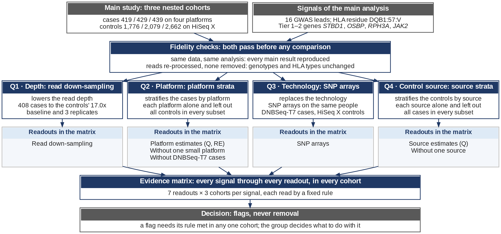

# check/platform_depth — is any association signal a technical artifact?

Every control of the study was sequenced on HiSeq X and every case on another platform, and depth differs by
platform. This component answers, for every signal and in each of the three nested cohorts (narrow, intermediate,
full mainland; each a selection of the full-mainland samples):

- **Does depth create the signal?** Every case platform but DNBseq-G400RS 15x is brought to the HiSeq X
  controls' median effective depth (the 89 NovaSeq and DNBSeq-G400RS 30x cases each to it, the 319 DNBSeq-T7 cases
  by one platform fraction), re-called (and re-typed) by the cohort's own procedure and re-tested (baseline f = 1
  plus three replicates).
- **Do the case platforms agree?** Each case platform against all controls (heterogeneity Q, I²), a
  by-platform meta-analysis against the pooled result, and leave-one-platform-out.
- **Does a second technology agree?** WGS against SNP arrays in the same people (DNBSeq-T7 cases and HiSeq X
  controls): `check/array_crosscheck`'s comparison re-run in each cohort (gate G10: full mainland reproduces it).
  The arrays were imputed with Minimac4 against the AGP3K whole-genome reference panel, which holds the controls'
  own genomes, so only the case side of the imputation counts.
- **Do the signals depend on where the controls come from?** Every case against each control source alone and
  with each source left out (Nagahama, BBJ, HTLV-1, ACC, lung cancer), every signal with its main model.
- **What lies behind a flag?** Descriptive counts and frequencies by group (case platform, registration study,
  control source, reference panels), the genotypes the filters set missing, and the single typings behind a
  DQB1:57:V change; not a check of the matrix.
- **How does every signal read across all checks?** The evidence matrix: every signal × every check × cohort, read
  by fixed rules. It flags and never removes a signal (user, 2026-10-31).

Signals: the 16 common-variant loci (168 signal variants), the Tier 1–2 genes (STBD1, OSBP, RPH3A, JAK2) in
both variant sets, and the HLA alleles, residues (DQB1:57:V) and positions (DQB1 57). Each is re-tested with
the main analysis' own model and pre-specified threshold. It replaces `check/down_sampling` (July 2026,
deleted; see [docs/REMOVED_down_sampling.md](docs/REMOVED_down_sampling.md)).

## Design at a glance



Platform coincides with case status, so no covariate can separate them: each way an artifact could arise is tested by
design instead (the threat model, [docs/DESIGN.md](docs/DESIGN.md) §2). The fidelity gates G1–G10 come first: the
re-test reproduces every published result, re-processing at f = 1 reproduces the genotypes, the depth and the HLA
typing, and the array re-run reproduces check/array_crosscheck, so a later change can only come from the factor an
experiment varies. Four experiments then each vary one factor, read depth (E1), case platform (E2), genotyping
technology (E3) and control source (E4), each in all three cohorts,
and feed the checks of the evidence matrix, which fixed rules read; a flag never removes a signal. One template per experiment with its positive and negative controls, the coverage of
samples and artifacts, the decision and the numbers flow: [docs/DESIGN.md](docs/DESIGN.md), written with its figures
(`docs/design/`) by `scripts/design_figures.py`.

## Design decisions (user, 2026-10-30)

| Question | Decision |
|---|---|
| Controls in the platform strata | shared: every stratum = one platform's cases + all controls (correlation handled) |
| Down-sampling target | every case platform but DNBseq-G400RS 15x at the HiSeq X controls' median effective depth, so each platform's median equals the controls' (2026-11-03): NovaSeq and DNBSeq-G400RS 30x each genome to it (the 89 deep cases, 2026-10-30), DNBSeq-T7 by one platform fraction (0.96528 = 16.99 / 17.60) |
| Replicates | three for every platform (2026-11-03, for uniformity); the first run's ten replicates of the deep cases (R from the pilot's cost rule) are kept in `results/_superseded/downsampling_R10/` |
| Scope | signals only (the gene-test λGC is not re-tested); genes = Tier 1–2 |
| Concordance | genotype and HLA concordance reported as results |

## Run

```bash
cd /LARGE0/gr10478/b37974/Pulmonary_Hypertension/cteph_agp3k.v6/check/platform_depth
bash run.sh report            # preflight, next run tag (report.N), detached launch, cache-miss guard
bash run.sh status            # driver, guard and log tail of the last run
bash run.sh verify            # = bash verify.sh downsampling: read-only; exit 0 = all passed
```

`bash run.sh <stage> [--dry-run] [--queue eb|gr10478b]` runs one stage: `inputs`, `gates`, `pilot`, `downsampling`,
`platform` or `report` (their `--run` arguments and run-tag prefixes: [docs/PIPELINE.md](docs/PIPELINE.md)). It
first checks that no other driver of this folder runs, that the frozen pieces are unchanged (`scripts/frozen.py
check` against `docs/FROZEN.manifest.tsv`), `nextflow lint`, and the queue; then it takes the next free run tag
(the trace never overwrites), resumes session `8eec4a16-3cd8-4479-a6b2-7d6b3d8ecc4c` with `-ansi-log false`, and
launches `nohup setsid … & disown` (`logs/<tag>.log`, driver PID in `logs/<tag>.pid`). A detached guard
(`logs/<tag>.guard.log`) sends SIGTERM to the driver, by PID, when a process that must be cached is submitted
(report: anything but the eight report processes; other stages: an inputs process). `--queue` switches both queues
when one is held (QOSGrpCpuLimit).

The cache (≈ 900 core-h behind it): never modify, move or `touch` the frozen scripts (the list in
`scripts/frozen.py`; `common.py` keeps mtime 2026-10-30 17:30:54), the process definitions outside the report stage
or the params they interpolate, nor `nextflow.config` beyond comments; never `nextflow run --help` (it runs) or
`-preview` (it poisons `-resume`); resources only through `--rsc`. The report stage is `cache false`: its scripts
(`ds_summary`, `platform_report`, `array_cohorts`, `array_evidence`, `control_report`, `signal_followup`,
`evidence_matrix`, `figures`, `catalogue`, with `report_lib.py` and the registry `checks.py`) can change freely.
What would touch a frozen piece, and its cost: [docs/REFACTOR_PROPOSAL.md](docs/REFACTOR_PROPOSAL.md).

## Where things are

| | |
|---|---|
| design: threat model, experiments, controls, coverage, decision, numbers flow | [docs/DESIGN.md](docs/DESIGN.md); figures and their sources in `docs/design/` (`scripts/design_figures.py`) |
| design, rules, formulas | [docs/METHODS.md](docs/METHODS.md) |
| stages, processes, the checks (artifact, samples, rule, table, figure, matrix column), gates | [docs/PIPELINE.md](docs/PIPELINE.md), written from the registry `scripts/checks.py` |
| every output file, table conventions | [docs/OUTPUTS.md](docs/OUTPUTS.md) |
| frozen pieces of the cached stages; refactors not applied | `docs/FROZEN.manifest.tsv` (`scripts/frozen.py`); [docs/REFACTOR_PROPOSAL.md](docs/REFACTOR_PROPOSAL.md) |
| gates | `results/_gates/` (G1–G5), `results/_gates/<label>/` (G6, G8, G9); G7 in `results/04.genotypes/<label>/<arm>/<cohort>/swap.*.json`; G10 in `results/11.array/array.gate.json` |
| depth and fractions | `results/01.depth/` |
| down-sampling results | `results/07.downsampling/<label>/` (concordance, QC reasons, HLA, `summary/ds.*`) |
| platform results | `results/10.platform/<cohort>/platform.*` |
| array evidence, per cohort | `results/11.array/` (`array.*`; the per-cohort re-run of `check/array_crosscheck` in `cohorts/<cohort>/`) |
| control sources | `results/12.controls/controls.*` |
| follow-up counts (descriptive), per cohort | `results/13.followup/` |
| evidence matrix (signal × check) | `results/14.evidence/` |
| figures | `results/figures/0N.<family>/` with one README each |

## Results

Runs: full.1 and full.3 (the 89 deep cases, platform and control-source subsets), full.4 (2026-11-03: the 319
DNBSeq-T7 cases added; baseline and three replicates for every down-sampled case; the 89's arms reused from the
cache), report.5; `verify.sh` all passed. Every number below is in the tables named; the evidence matrix
(`results/14.evidence`, figure `06.evidence/evidence_matrix`) holds every signal × every check × cohort. **No signal
is removed** (user, 2026-10-31); two carry a flag.

- **Machinery.** Gates G1–G10 pass: the re-test reproduces the published SAIGE, rvtest and HLA results;
  re-processing at f = 1 reproduces every genotype of the 408 down-sampled cases (concordance 1.000) and every HLA
  call (7,752 identical); achieved/target depth median 1.000 (0.987–1.010) over 1,224 genome-arms; the array
  re-run in full mainland reproduces check/array_crosscheck (G10).
- **Depth (E1).** The 408 down-sampled cases carry about 93 % of the cases' ALT copies at the GWAS signals. At the
  controls' depth the re-called genotypes agree with the f = 1 baseline at ≥ 0.9997 of both-called genotypes;
  QC-rule failures rise to 1.9 % (DNBSeq-T7 1.5 % → 1.9 %; NovaSeq and DNBSeq-G400RS 30x 0.05–0.19 % →
  1.8–2.3 %; controls 2.5 %), so the emulation reaches the controls' level. No signal moves: the replicate-median
  |z| of every GWAS lead falls by ≤ 0.22 (rule: > 1); Tier 1–2 case carriers are unchanged except STBD1 (one
  carrier fewer in some replicates), whose Bonferroni calls in full mainland hold in 3 of 3 replicates; DQB1:57:V
  stays below its GEC threshold in 3 of 3 replicates in every cohort (OR 0.651–0.656 vs 0.656, full mainland).
- **Platform (E2).** No heterogeneity flag; leaving the DNBSeq-T7 cases out flags ADARB2 (3/3 cohorts; 0 copies of
  a 3.6 % deletion in T7 cases, not array-checkable) and LINC01146 (2/3; NovaSeq cases ≈ T7, the two small
  G400RS groups lower; T7 genotypes confirmed by array imputation).
- **Arrays (E3), every cohort.** The same verdicts in narrow, intermediate and full mainland: 8 signals reproduced on
  arrays, 9 with case genotypes confirmed, JAK2 partly, CDH4 and PHF20L1 not confirmed (case imputation r² below
  0.8), ADARB2 not checkable; none contradicted. λ on WGS and arrays agree (1.120/1.128, 1.123/1.130, 1.144/1.143),
  z correlation 0.986 in each cohort.
- **Control sources (E4).** No flag. RPH3A carriers are fewer among Nagahama controls than in the other sources;
  pooled controls match ToMMo.
- **Follow-up counts (descriptive), every cohort.** Re-applied genotype filters reproduce every published genotype
  (103 cohort × variant rows); ADARB2's deletion has no carrier and no ALT read in the pre-QC records of the 319
  DNBSeq-T7 cases.
