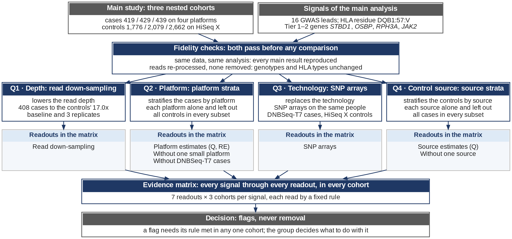
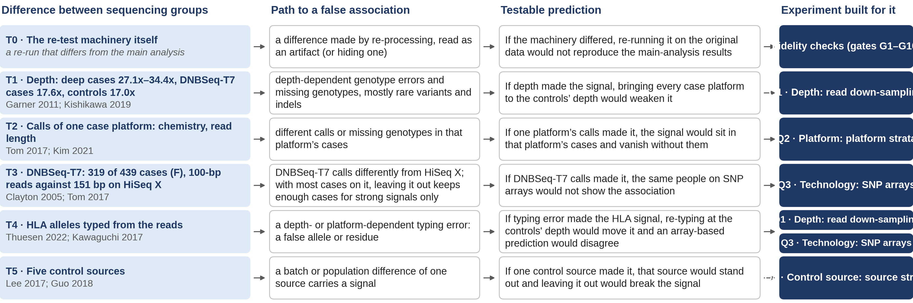
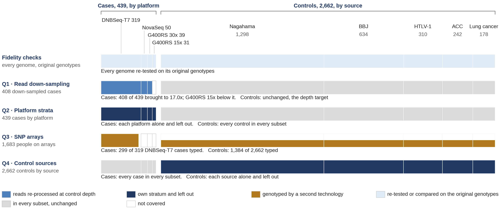
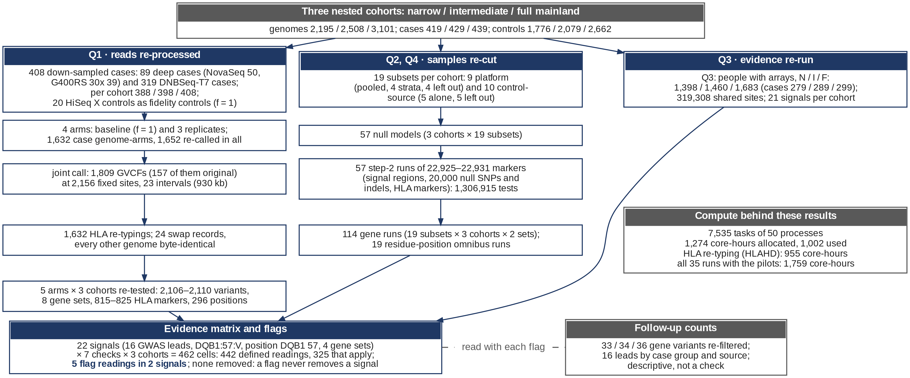
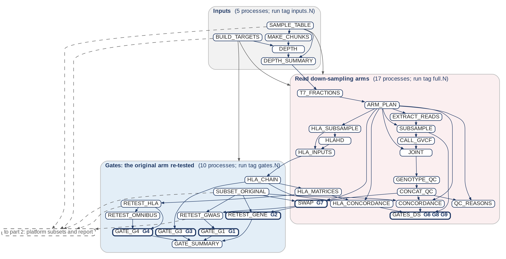
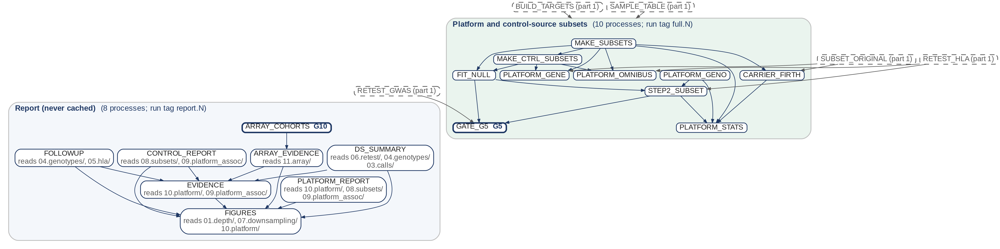

# Design — `check/platform_depth`

How the validation is designed: the threat model, the fidelity layer, four questions (Q1–Q4), each answered by one experiment in one template, their controls and coverage, the decision rules, and the units at every step. Written by `scripts/design_figures.py` from the registry (`scripts/checks.py`), the result tables (`results/`) and the run traces; do not edit by hand (`--check-doc` fails when it is out of date). Formulas: [METHODS.md](METHODS.md); processes and checks: [PIPELINE.md](PIPELINE.md); files: [OUTPUTS.md](OUTPUTS.md); results: [README](../README.md#results). Part II of the deck (`deck/`) draws the same figures and cards.

Contents: [1 At a glance](#1-at-a-glance) · [2 Threat model](#2-threat-model) · [3 Fidelity layer](#3-fidelity-layer-gates-g1g10) · [4 Questions](#4-questions-one-experiment-each-one-template) · [5 Controls](#5-positive-and-negative-controls) · [6 Coverage](#6-coverage) · [7 Decision](#7-from-readouts-to-a-decision) · [8 Numbers flow](#8-numbers-flow) · [9 Process graph](#9-process-graph) · [10 Limitations](#10-limitations) · [11 Figures](#11-how-the-figures-are-made)

## 1. At a glance



Platform coincides with case status: every control was sequenced on HiSeq X (151-bp reads, 17.0x), every case on one of four other platforms. A platform term would absorb case status, so each way an artifact could arise is tested by design instead. The main study and its signals first pass the fidelity gates G1–G10: the re-test machinery reproduces every main-analysis result before anything is compared, so a later change can only come from the factor an experiment varies. Four questions, Q1 depth, Q2 platform, Q3 technology and Q4 control source, are each answered by one experiment that varies one factor, in all three nested cohorts; each re-tests or reads every signal with its own model and threshold, and feeds named checks: the columns of the evidence matrix (22 signals × 7 checks × 3 cohorts, 462 cells: 442 defined readings, 325 that apply). Fixed rules read the matrix; a flag never removes a signal; the group decides. "Consistent" means not flagged, not shown robust. The cohorts share most of their samples: agreement across them shows stability to sample selection, not replication.

## 2. Threat model



Each row is a way an artifact could reach the association; its prediction names what an experiment must see if the artifact made the signal. "Tests" = the experiment can detect it directly; "partly" = only part of the mechanism; which samples each experiment involves is shown in §6.

|  | Difference between sequencing groups | Evidence | Path to a false association | Testable prediction | Tests | Partly |
|---|---|---|---|---|---|---|
| T0 | The re-test machinery itself | a re-run that differs from the main analysis | a difference made by re-processing, read as an artifact (or hiding one) | If the machinery differed, re-running it on the original data would not reproduce the main-analysis results | Fidelity checks (gates G1–G10) | — |
| T1 | Depth: deep cases 27.1x–34.4x, DNBSeq-T7 cases 17.6x, controls 17.0x | Garner 2011; Kishikawa 2019 | depth-dependent genotype errors and missing genotypes, mostly rare variants and indels | If depth made the signal, bringing every case platform to the controls’ depth would weaken it | Q1 | Q2, Q3 |
| T2 | Calls of one case platform: chemistry, read length | Tom 2017; Kim 2021 | different calls or missing genotypes in that platform’s cases | If one platform’s calls made it, the signal would sit in that platform’s cases and vanish without them | Q2 | Q1, Q3 |
| T3 | DNBSeq-T7: 319 of 439 cases (F), 100-bp reads against 151 bp on HiSeq X | Clayton 2005; Tom 2017 | DNBSeq-T7 calls differently from HiSeq X; with most cases on it, leaving it out keeps enough cases for strong signals only | If DNBSeq-T7 calls made it, the same people on SNP arrays would not show the association | Q3 | Q2 |
| T4 | HLA alleles typed from the reads | Thuesen 2022; Kawaguchi 2017 | a depth- or platform-dependent typing error: a false allele or residue | If typing error made the HLA signal, re-typing at the controls' depth would move it and an array-based prediction would disagree | Q1, Q3 | Q2 |
| T5 | Five control sources | Lee 2017; Guo 2018 | a batch or population difference of one source carries a signal | If one control source made it, that source would stand out and leaving it out would break the signal | Q4 | — |

## 3. Fidelity layer (gates G1–G10)

Nothing is compared before the machinery reproduces the main-analysis results; the baseline (f = 1: every read, through the same new processing) reproduces the original genotypes and typing, and the array comparison re-run in full mainland reproduces check/array_crosscheck. A difference introduced by the re-test machinery would otherwise be read as an artifact (threat T0). Blind spot: a flaw shared by the original and the re-test (same software, same settings) passes the gates. All 10 gates pass.

| Gate | What is reproduced | Rule | Process | Record | Result |
|---|---|---|---|---|---|
| G1 | SAIGE step 2 on the ORIGINAL genotypes reproduces assoc_saige's saige.assoc.tsv | every row present; relative difference <= 1e-6 in every compared column | `GATE_G1` | `_gates/G1.<cohort>.json` | 2,110 / 2,106 / 2,108 variants; largest relative difference 0 |
| G2 | rvtest on the ORIGINAL genotypes reproduces the published gene P, OR and carriers | no mismatching row | `RETEST_GENE` | `_gates/G2.<cohort>.<set>.json` | 6 cohort × variant-set scans; mismatching rows 0 |
| G3 | the hla.typing.v2 wrapper reproduces the six 06.assoc_inputs matrices | md5 identical | `GATE_G3` | `_gates/G3.json` | 6 of 6 files identical |
| G4 | the HLA re-test reproduces assoc_all.tsv and the residue-position omnibus | the same rows; relative difference <= 1e-6 | `GATE_G4` | `_gates/G4.json` | 2,461 single-marker and 888 omnibus rows; largest relative difference 0 |
| G5 | the pooled null re-fit reproduces the published null model | variance ratio and median z within 1 % | `GATE_G5` | `_gates/G5.<cohort>.json` | variance ratio within 6.6 × 10⁻⁷, z within 3.4 × 10⁻⁴ |
| G6 | re-processing fidelity: baseline, re-genotyped original GVCFs and original agree | concordance >= 99.5 %, call rate within 0.5 percentage points | `GATES_DS` | `_gates/<label>/G6.json` | concordance 1.000: 408 down-sampled cases (862,678 genotypes), 20 HiSeq X controls; call rate 0.98621 original, 0.98624 re-processed |
| G7 | the swap leaves every genome but the deep cases' byte-identical | bedio.py swap aborts otherwise | `SWAP` | `04.genotypes/<label>/<arm>/<cohort>/swap.{gwas,gene}.json` | 24 swap records; any other change aborts |
| G8 | achieved depth: depth after / (f x depth before) over the calling intervals | median 0.95-1.05, every genome 0.85-1.15 | `GATES_DS` | `_gates/<label>/G8.json` | 1,224 genome-arms: median 1.000 (0.987–1.010) |
| G9 | HLA re-typing at f = 1 reproduces the archived typing | every call identical | `GATES_DS` | `_gates/<label>/G9.json` | 7,752 calls; differing 0 |
| G10 | the array comparison re-run in full mainland reproduces check/array_crosscheck's tables | same rows and text; numbers within 1e-6 relative | `ARRAY_COHORTS` | `11.array/array.gate.json` | 7 tables; largest relative difference 1.3 × 10⁻⁷ |

## 4. Questions, one experiment each, one template

Every experiment is described by the same fields. "Perturbed" gives the narrow / intermediate / full mainland counts (N / I / F). Each feeds the evidence-matrix checks of the registry named in its heading; every check is read in all three cohorts.

### Q1 · Depth: read down-sampling — reduces depth

Checks: `depth` · METHODS §3, §5

| Field | Content |
|---|---|
| **Question** | Does depth make the signal? If it did, bringing every case platform to the controls' depth would weaken it (threat T1; also T4 for the HLA typing). |
| **Factor varied** | Reduced: the read depth of 408 cases, so that every case platform but DNBseq-G400RS 15x has the HiSeq X controls' median effective depth, D* = 16.99x. Each of the 89 deep cases (NovaSeq, DNBSeq-G400RS 30x) keeps f = D* / D_i of its read pairs (f 0.54–0.68 NovaSeq, 0.39–0.58 G400RS 30x); the 319 DNBSeq-T7 cases keep one platform fraction, f = D* / 17.60x = 0.96528, which keeps their own spread of depth. Mates stay together (a hash of the read name and the seed). Arms: a baseline at f = 1 and 3 replicates (r01, r02, r03). |
| **Held constant** | Every other genome (byte-identical; G7) and the variant set (the fixed sites); the cohort's calling, joint genotyping and genotype QC; the null models of the main analysis, each analysis' model and threshold; for HLA the same HLA-HD install, dictionary and options and the original tested columns. |
| **Perturbed (N / I / F)** | Down-sampled cases 388 / 398 / 408 (93 % / 93 % / 93 % of the cases 419 / 429 / 439): the 89 deep cases in every cohort and the DNBSeq-T7 cases each cohort holds (299 / 309 / 319); the 31 G400RS 15x cases (13.8x) are not touched; 20 HiSeq X controls are re-processed at f = 1 only (fidelity). |
| **Comparator** | Depth effect: each replicate against the baseline (identical processing, only the reads differ). Re-processing: the baseline against the original genotypes. Total: replicate against original. |
| **Model and statistic** | Each signal's own analysis: logistic mixed model step 2 on the null model of the main analysis (GWAS leads, HLA alleles and residues), CMC and SKAT-O (genes), the residue-position omnibus; z from the two-sided P. |
| **Readout** | Replicate-median \|z\| against the original \|z\|; replicates still significant; genotype concordance (confusion counts, non-reference concordance, heterozygotes retained, call rate) per platform; the share of genotypes each QC rule no-calls, per cohort; HLA calls and dosages per arm. |
| **Decision rule** | read down-sampling of the down-sampled cases: flag if the replicate-median \|z\| is more than 1 below the original \|z\| (z from the two-sided P); in any one cohort. |
| **Positive control** | The manipulation must work: achieved / target depth over the calling intervals (G8, 1,224 genome-arms, median 1.000, 0.987–1.010); the share of genotypes failing a QC rule moves to the controls' (full mainland: deep cases 0.09 % original, NovaSeq 2.1 %–2.3 % and G400RS 30x 1.8 %–1.9 % in the replicates; DNBSeq-T7 1.48 % original, 1.9 %–1.9 % in the replicates; controls 2.46 %). |
| **Negative control** | The baseline must change nothing: concordance 1.000 with the original genotypes (G6) and 7,752 HLA calls identical (G9); 20 HiSeq X fidelity controls go through the same new processing. |
| **Blind spot** | The G400RS 15x cases (13.8x: depth cannot be added); a platform effect that is not a depth effect, such as read length or chemistry (the DNBSeq-T7 cases lose only 3.5 % of their reads). Covered by Q2 and Q3. |
| **Processing chain** | T7_FRACTIONS → ARM_PLAN → EXTRACT_READS → SUBSAMPLE → CALL_GVCF → JOINT → GENOTYPE_QC → CONCAT_QC → SWAP → RETEST_GWAS, RETEST_GENE; HLA_SUBSAMPLE → HLAHD → HLA_INPUTS → HLA_CHAIN → HLA_MATRICES → RETEST_HLA → RETEST_OMNIBUS; CONCORDANCE, QC_REASONS, HLA_CONCORDANCE → GATES_DS; DS_SUMMARY |
| **Output tables** | `07.downsampling/<label>/summary/ds.{gwas,hla_dqb1_57v,positions,genes}.tsv`; `07.downsampling/<label>/{concordance,qc_reasons,hla}/`; `07.downsampling/<label>/summary/ds.{exposure,qc_reasons}.tsv` |

### Q2 · Platform: platform strata — stratifies the cases by platform

Checks: `platform_Q`, `platform_RE`, `lopo` · METHODS §6a, §6b, §6c, §10

| Field | Content |
|---|---|
| **Question** | Do the four case platforms agree, and does any one carry the signal? If one platform's calls made it, the signal would sit in that platform's cases and vanish without them (threat T2). |
| **Factor varied** | Stratified: the cases by platform. Per cohort the pooled set, four strata (one platform's cases) and four leave-one-platform-out sets: 9 subsets, each with a separate null model. |
| **Held constant** | Every control in every subset; the original genotypes; each signal's model (sex and 10 principal components), GRM markers and threshold. |
| **Perturbed (N / I / F)** | Cases by platform: DNBSeq-T7 299 / 309 / 319; NovaSeq 50 / 50 / 50; G400RS 30x 39 / 39 / 39; G400RS 15x 31 / 31 / 31; controls 1,776 / 2,079 / 2,662 in every subset. |
| **Comparator** | The strata against each other (heterogeneity); the random-effects estimate against the pooled one; each platform left out against z_exp = pooled β / SE without it; the difference β_k − β_(−k). |
| **Model and statistic** | Per subset its own null model and step 2. Across strata: GLS with the shared-control correlation ρ_kl = √(n_k n_l / ((n_k + n_0)(n_l + n_0))) (Lin & Sullivan 2009); Q (Cochran 1954) and I² (Higgins & Thompson 2002); REML with Hartung–Knapp (Hartung & Knapp 2001; IntHout 2014) against the pooled estimate (Evangelou & Ioannidis 2013), at MAF ≥ 5 %; case-only multinomial LRT (Begg & Zhang 1994). Genes: CMC burden β per subset. |
| **Readout** | Q, its P read empirically against null SNPs of the same MAF bin and type, I²; the random-effects OR against the pooled OR; z observed against z expected and P_diff. |
| **Decision rule** | platform_Q: heterogeneity across the four case platforms (shared controls): flag if the empirical P of Q < 0.05 / number of SAIGE signals; applied at MAF >= 5% only (the threshold is 0.0029); platform_RE: random-effects estimate (REML, Hartung-Knapp) on the other side of the null from the pooled one; applied at MAF >= 5% only (as Q: SAIGE's one-step stratum beta is unreliable in small strata); lopo: leave one case platform out: flag if a left-out platform has \|z expected\| >= 2.8 (z expected = pooled beta / SE without it) and \|z observed\| < 1.96 or the opposite sign; genes: the CMC burden beta. A flag in any one cohort. |
| **Positive control** | None by design (no signal with a known platform effect); each stratum carries its power to detect heterogeneity if that stratum had no effect. Post hoc, the strata flag the ADARB2 lead, whose deletion the DNBSeq-T7 calls miss although the T7 reads carry it (deck CRAM check, 2026-11-06). The testability bar is not a control: it sets aside readings where a large group (DNBSeq-T7) is left out; a small group passes it and barely moves z. |
| **Negative control** | 20,000 random LD-pruned SNPs and indels by MAF bin: Q P < 0.05 in 4.7 % / 5.2 % / 5.2 %; the analytic ρ against the correlation of z over the null SNPs (0.013–0.063 against 0.002–0.114, three cohorts); G5: the pooled re-fit reproduces the null model of the main analysis. |
| **Blind spot** | DNBSeq-T7 holds most of the cases, so leaving them out is testable only for strong signals (covered by Q3); genes (0–7 carriers per stratum: no per-stratum estimate); small strata often "not testable"; an artifact confined to a small stratum barely moves z without it and is read by P_diff (§5). |
| **Processing chain** | MAKE_SUBSETS → FIT_NULL → STEP2_SUBSET (with PLATFORM_GENO) → PLATFORM_STATS → PLATFORM_REPORT; PLATFORM_GENE, CARRIER_FIRTH, PLATFORM_OMNIBUS; GATE_G5 |
| **Output tables** | `10.platform/<cohort>/platform.{heterogeneity,lopo}.tsv`; `09.platform_assoc/<cohort>/gene.without_*.tsv`; `14.evidence/evidence.loo.tsv`; `10.platform/<cohort>/platform.{strata,case_only,rho,null_calibration,null_Q}.tsv` |

### Q3 · Technology: SNP arrays — replaces the genotyping technology

Checks: `array` · METHODS §7

| Field | Content |
|---|---|
| **Question** | Does a second technology give the same answer in the same people? If a DNBSeq-T7 calling error made the signal, the arrays, which type the DNBSeq-T7 cases and the HiSeq X controls, would disagree (threat T3; also T4). |
| **Factor varied** | Replaced: the WGS genotypes by SNP-array data of the same people, one marker per signal: the lead typed, else imputed (R² ≥ 0.8), else a typed LD proxy (r² ≥ 0.8); DQB1:57:V imputed with HIBAG's published Asian model, which never saw our WGS typing; gene drivers (full mainland only): their WGS case carriers looked up on the imputed arrays. check/array_crosscheck's comparison is re-run in each cohort with that cohort's unrelated members, phenotype and covariates; G10: the full-mainland re-run reproduces it. |
| **Held constant** | The people, the marker and the allele; the shared sites, the association model (sex and 10 principal components) and the procedures of check/array_crosscheck (read only). |
| **Perturbed (N / I / F)** | People with arrays 1,398 / 1,460 / 1,683: DNBSeq-T7 cases (ASA24v1) 279 / 289 / 299, HiSeq X controls (JSA24v1) 1,119 / 1,171 / 1,384; the NovaSeq and G400RS cases have no array. |
| **Comparator** | The WGS result in the same people, at the same marker and allele. |
| **Model and statistic** | Typed on both sides: the array association against the WGS one. Imputed: the arrays were imputed with Minimac4 (v4.1.4, per the header of the imputed VCF) against the AGP3K whole-genome reference panel; that panel holds the controls' own genomes, so only the cases' imputed genotypes are independent of WGS. Gene drivers: the WGS case carriers that the imputed arrays confirm (dosage ≥ 0.5), counted once in full mainland. |
| **Readout** | GWAS leads and DQB1:57:V, per cohort: z on WGS and on the array, consistent, not checkable, or contradicted. Genes: case carriers confirmed of the WGS carriers, one cell for the three cohorts (a description, no verdict). |
| **Decision rule** | SNP arrays (DNBSeq-T7 cases, HiSeq X controls): flag if the opposite direction or \|z WGS - z array\| > 3, in any cohort; the array P is not required; genes reported, never flagged; contradicted = opposite direction or \|z_WGS − z_array\| > 3; the array P is not required. A flag in any one cohort. Genes: no rule (a missed rare carrier is expected of imputation). |
| **Positive control** | Genome-wide sites with \|z_WGS − z_array\| > 4: 6 / 5 / 5; the five in full mainland are array-side calling errors in cases (check/array_crosscheck). The sites with WGS P < 10⁻⁴ that show the same direction with array P < 0.01: 58 of 58 / 77 of 77 / 67 of 67; the z correlation is 0.986 / 0.986 / 0.986. |
| **Negative control** | Concordance 0.999883 / 0.999882 / 0.999882 in cases and 0.999836 / 0.999836 / 0.999837 in controls over 319,308 shared sites. (λ 1.120 / 1.128 / 1.123 / 1.130 / 1.144 / 1.143, WGS / array, is inflation both technologies share, not a negative control.) |
| **Blind spot** | The NovaSeq and G400RS cases; imputed controls (they copy their own genomes); indels without a proxy (the ADARB2 lead); rare carriers the imputation misses, and an acquired variant (JAK2 p.Val617Phe) absent from the imputed arrays; an error shared by WGS and arrays: the arrays are confounded with case status too, by another technology. |
| **Processing chain** | ARRAY_COHORTS (cached; array_cohorts.py: check/array_crosscheck's compare, rare-direct and imputed steps re-run per cohort from its inputs, gate G10; array_hibag.py: DQB1 with HIBAG) → ARRAY_EVIDENCE (array_evidence.py: the verdict per signal and the gene carrier counts) |
| **Output tables** | `11.array/array.{signals,evidence}.tsv`; `11.array/cohorts/<cohort>/`; `11.array/array.{summary,gate}.json` |

### Q4 · Control source: source strata — stratifies the controls by source

Checks: `sources_Q`, `sources_loo` · METHODS §8, §10

| Field | Content |
|---|---|
| **Question** | Does any one of the five control sources carry a signal? If one source made it, that source would stand out, and leaving it out would break the signal (threat T5). |
| **Factor varied** | Stratified: the controls by source (the info sheet's Project): every case against one source's controls and against all sources but one: 10 subsets per cohort, each with its own null model. |
| **Held constant** | Every case in every subset; the original genotypes; each signal's main model and threshold. |
| **Perturbed (N / I / F)** | Controls by source: Nagahama 1,075 / 1,108 / 1,298; BBJ 195 / 342 / 634; HTLV-1 168 / 241 / 310; ACC 198 / 227 / 242; Lung cancer 140 / 161 / 178; cases 419 / 429 / 439 in every subset. |
| **Comparator** | The sources against each other; each source left out against z_exp; one source against the rest. |
| **Model and statistic** | As Q2 with cases and controls swapped: GLS with ρ_kl = √(m_k m_l / ((m_k + n)(m_l + n))), m a source's controls, n the cases (Lin & Sullivan 2009); Q with its analytic χ² P, I²; genes CMC and SKAT-O per subset (carriers per source descriptive); positions: the omnibus. |
| **Readout** | Q P and I² across the five sources; z observed against z expected without each source; the genes' P, OR and carriers per subset. |
| **Decision rule** | sources_Q: heterogeneity across the five control sources (shared cases): flag if the analytic (chi-square) P of Q < 0.05 / number of SAIGE signals; applied at MAF >= 5% only; sources_loo: leave one control source out: as lopo. For a rare variant in a small source subset the one-step β is unreliable: leaving a source out is read first. |
| **Positive control** | None by design (no source with a known effect); every GWAS and HLA reading is testable here, since all cases stay. |
| **Negative control** | λ over the 20,000 null SNPs in every subset, 0.976–1.050; \|z\| > 3 in 0.21%–0.39% of them (0.27% expected). |
| **Blind spot** | A difference shared by all five sources, such as their common HiSeq X platform (covered by Q3); genes: 0–3 carriers per source, no per-source estimate. Pooling controls from different projects is a known source of false positives (Lee 2017; Guo 2018); that is what the check targets. |
| **Processing chain** | MAKE_SUBSETS → MAKE_CTRL_SUBSETS → FIT_NULL → STEP2_SUBSET; PLATFORM_GENE; PLATFORM_OMNIBUS; CONTROL_REPORT |
| **Output tables** | `12.controls/controls.{heterogeneity,loo,genes,positions}.tsv`; `14.evidence/evidence.loo.tsv`; `12.controls/controls.{counts,strata,null_lambda,signals}.tsv` |

## 5. Positive and negative controls

A positive control shows that the manipulation or the test could detect what it targets; a negative control shows that it changes nothing, or stays calibrated, where nothing should change.

| Experiment | Positive control | Negative control |
|---|---|---|
| Q1 · Depth: read down-sampling | The manipulation must work: achieved / target depth over the calling intervals (G8, 1,224 genome-arms, median 1.000, 0.987–1.010); the share of genotypes failing a QC rule moves to the controls' (full mainland: deep cases 0.09 % original, NovaSeq 2.1 %–2.3 % and G400RS 30x 1.8 %–1.9 % in the replicates; DNBSeq-T7 1.48 % original, 1.9 %–1.9 % in the replicates; controls 2.46 %). | The baseline must change nothing: concordance 1.000 with the original genotypes (G6) and 7,752 HLA calls identical (G9); 20 HiSeq X fidelity controls go through the same new processing. |
| Q2 · Platform: platform strata | None by design (no signal with a known platform effect); each stratum carries its power to detect heterogeneity if that stratum had no effect. Post hoc, the strata flag the ADARB2 lead, whose deletion the DNBSeq-T7 calls miss although the T7 reads carry it (deck CRAM check, 2026-11-06). The testability bar is not a control: it sets aside readings where a large group (DNBSeq-T7) is left out; a small group passes it and barely moves z. | 20,000 random LD-pruned SNPs and indels by MAF bin: Q P < 0.05 in 4.7 % / 5.2 % / 5.2 %; the analytic ρ against the correlation of z over the null SNPs (0.013–0.063 against 0.002–0.114, three cohorts); G5: the pooled re-fit reproduces the null model of the main analysis. |
| Q3 · Technology: SNP arrays | Genome-wide sites with \|z_WGS − z_array\| > 4: 6 / 5 / 5; the five in full mainland are array-side calling errors in cases (check/array_crosscheck). The sites with WGS P < 10⁻⁴ that show the same direction with array P < 0.01: 58 of 58 / 77 of 77 / 67 of 67; the z correlation is 0.986 / 0.986 / 0.986. | Concordance 0.999883 / 0.999882 / 0.999882 in cases and 0.999836 / 0.999836 / 0.999837 in controls over 319,308 shared sites. (λ 1.120 / 1.128 / 1.123 / 1.130 / 1.144 / 1.143, WGS / array, is inflation both technologies share, not a negative control.) |
| Q4 · Control source: source strata | None by design (no source with a known effect); every GWAS and HLA reading is testable here, since all cases stay. | λ over the 20,000 null SNPs in every subset, 0.976–1.050; \|z\| > 3 in 0.21%–0.39% of them (0.27% expected). |

The leave-one-out rule compares z without a group with z expected = β_pooled / SE without the group. Given the pooled estimate, z without the group follows N(z_exp, sd = √(1 − (z_exp / z_pooled)²)): the winner's curse inflates z_pooled and z_exp alike and does not bias the comparison. The sd is 0.75–0.86 without the DNBSeq-T7 cases and 0.20–0.40 without a small group (GWAS and HLA markers); the testability bar excludes large groups (low z_exp) only, while a small group always passes it and barely moves z, so an excess confined to a small group is only described, by P_diff and, for a rare lead (whose one-step stratum β is unreliable), by its allele counts. On the null SNPs the model holds for every platform left out; for the control sources it is approximate (each subset has its own null model), so their chances are nominal. `14.evidence/evidence.loo_calibration.tsv` gives the flags observed against those expected by chance.

## 6. Coverage



Each strip is every genome of full mainland on one scale, cases by platform and controls by source; color = what the experiment does to that group. No single experiment sees every sample: the DNBSeq-T7 and deep cases are covered by at least two, the 31 G400RS 15x cases by the platform strata alone.

| Threat | Gates | Q1 | Q2 | Q3 | Q4 |
|---|---|---|---|---|---|
| T0 Re-test discrepancy | ● | · | · | · | · |
| T1 Depth-dependent genotyping error | · | ● | ◐ | ◐ | · |
| T2 Platform-specific genotyping error | · | ◐ | ● | ◐ | · |
| T3 DNBSeq-T7 genotyping error relative to HiSeq X | · | · | ◐ | ● | · |
| T4 Read-based HLA typing error | · | ● | ◐ | ● | · |
| T5 Control-source heterogeneity | · | · | · | · | ● |

● tests it directly · ◐ partly (only part of the mechanism) · · blind. How the blind spots are covered: a DNBSeq-T7 calling error (T3) is seen by the strata only where leaving the DNBSeq-T7 cases out is testable (they are most of the cases); the arrays (Q3) test it directly in the same people with a second technology. Depth is varied in every case platform but G400RS 15x ({DS["untouched"]} cases below the controls' depth: depth cannot be added); a read-length or chemistry effect is not a depth effect and is left to the strata and the arrays. Imputed arrays cannot test controls (their panel is the controls' own genomes); a control-side error shared by all five sources is not separable from population or panel differences. Indels without a proxy escape the arrays: the ADARB2 lead is seen by the strata only.

## 7. From readouts to a decision

1. **Reading.** Each signal × check × cohort is read by the check's fixed rule. *consistent*: the check agrees with the signal (arrays: same direction and |z WGS - z array| <= 3); *flag*: the check disagrees; flags, never removes; *not testable*: no left-out group has |z expected| >= 2.8; *not applicable*: the check does not apply (Q and random effects at MAF < 5 %; per-stratum estimates of genes); *reported*: a number without a rule (the residue position; the case carriers of a gene's drivers confirmed on the imputed arrays: one cell for the three cohorts, counted in full mainland, which contains the other two); *not checkable*: arrays: not typed, not imputed with R2 >= 0.8, no LD proxy with r2 >= 0.8 (genes: no driver in the imputed arrays).
2. **Cohort-wise rule.** Every check is read in each of the three cohorts and flags a signal when its rule holds in any one of them; the number of cohorts flagged is reported with the flag.
3. **Flag.** The signal carries the flag in the matrix and in `14.evidence/evidence.signals.tsv`; a flag never removes a signal.
4. **Look behind.** P_diff and the descriptive follow-up counts (`13.followup`) are read with every flag.
5. **Decision.** Which flag keeps a locus out of the paper is the group's decision (no signal is excluded for now). The rules were fixed before the final readings and are to be confirmed by the group. Three changes came after review: the random-effects rule was restricted, like Q, to MAF ≥ 5 %; 3 replicates for every platform was the group's choice after the first run; and every check flags a signal when its rule holds in any one cohort, not two of three (2026-11-04: the cohorts are nested, so a second cohort adds little, and a flag only prompts a closer look).

Thresholds (registry): leave-one-out |z expected| ≥ 2.8, |z observed| < 1.96; depth Δ|z| > 1; heterogeneity 0.05 / the number of SAIGE signals at MAF ≥ 0.05 (= 0.0029).

| Check | Experiment | Rule (`evidence.rules.tsv`) |
|---|---|---|
| `discovery` Discovery | main analysis | the main analysis: P against its pre-specified threshold (GWAS 5e-8, suggestive 1e-5; genes Bonferroni; HLA residues GEC; positions Bonferroni); a reading, never a flag |
| `depth` Read down-sampling | Q1 | read down-sampling of the down-sampled cases: flag if the replicate-median \|z\| is more than 1 below the original \|z\| (z from the two-sided P) |
| `platform_Q` Platform heterogeneity | Q2 | heterogeneity across the four case platforms (shared controls): flag if the empirical P of Q < 0.05 / number of SAIGE signals; applied at MAF >= 5% only |
| `platform_RE` Random effects across platforms | Q2 | random-effects estimate (REML, Hartung-Knapp) on the other side of the null from the pooled one; applied at MAF >= 5% only (as Q: SAIGE's one-step stratum beta is unreliable in small strata) |
| `lopo` Leave one platform out | Q2 | leave one case platform out: flag if a left-out platform has \|z expected\| >= 2.8 (z expected = pooled beta / SE without it) and \|z observed\| < 1.96 or the opposite sign; genes: the CMC burden beta |
| `array` SNP arrays | Q3 | SNP arrays (DNBSeq-T7 cases, HiSeq X controls): flag if the opposite direction or \|z WGS - z array\| > 3, in any cohort; the array P is not required; genes reported, never flagged |
| `sources_Q` Control-source heterogeneity | Q4 | heterogeneity across the five control sources (shared cases): flag if the analytic (chi-square) P of Q < 0.05 / number of SAIGE signals; applied at MAF >= 5% only |
| `sources_loo` Leave one control source out | Q4 | leave one control source out: as lopo |

## 8. Numbers flow



| Step | Units |
|---|---|
| Cohorts (N / I / F) | genomes 2,195 / 2,508 / 3,101; cases 419 / 429 / 439; controls 1,776 / 2,079 / 2,662 |
| Q1 genomes | 408 down-sampled cases: 89 deep cases (the same in every cohort) and 319 DNBSeq-T7 cases (f = 0.96528); per cohort 388 / 398 / 408; 20 HiSeq X fidelity controls |
| Q1 arms | 4 arms (baseline and 3 replicates): 1,632 case genome-arms; 1,652 re-called with the fidelity controls |
| Q1 joint call | 1,809 GVCFs (157 original) at 2,156 fixed sites (168 signal, 1,952 context, 36 gene) in 23 calling intervals (930 kb) |
| Q1 HLA and swaps | 1,632 HLA re-typings; 24 swap records |
| Q1 re-tests | 5 arms × 3 cohorts: 2,106–2,110 variants, 8 gene sets, 815–825 HLA markers, 296 positions |
| Q2, Q4 subsets | 19 per cohort (9 platform, 10 control-source): 57 null models |
| Q2, Q4 tests | 57 step-2 runs of 22,925–22,931 markers (20,000 of them null SNPs and indels): 1,306,915 tests; 114 gene runs; 19 omnibus runs |
| Q3 | people with arrays 1,398 / 1,460 / 1,683 (cases 279 / 289 / 299, controls 1,119 / 1,171 / 1,384); 319,308 shared sites; 21 signals per cohort; imputed with Minimac4 v4.1.4 |
| Follow-up counts | 33 / 34 / 36 gene variants × 2,165 / 2,477 / 3,068 genomes re-filtered; 16 leads by group (descriptive, not a check) |
| Signals | 16 GWAS loci (168 signal variants: 16 leads, 3 alternative leads, 149 credible-set members); 4 Tier 1–2 genes in 8 gene sets (36 tested variants); HLA 142–144 alleles and 672–681 residues, 296 positions |
| Matrix | 22 signals × 7 checks × 3 cohorts = 462 cells: 442 defined readings, 325 that apply (and 66 discovery readings); 5 flag readings in 2 signals (ADARB2, LINC01146); none removed |
| Compute | behind these results 7,535 tasks of 50 processes, 1,273.6 core-hours allocated (1,002.1 CPU-hours used); by stage inputs 28.3, gates 2.6, downsampling 1,103.2, platform 139.1, report 0.4; all 35 runs with the pilots: 10,803 tasks, 1,758.7 core-hours. |

Core-hours: each task's realtime × the cores `nextflow.config` gives its process (`--rsc c=`); "used" = realtime × %cpu. Tasks behind these results: those the latest full run and the latest report run used, each counted once at the run that executed it.

Replicates: 3 for every platform, our choice for uniformity. The pilot measured the cost of every down-sampling process per task; its cost rule (the largest R in 3–10 within 1,000 core-hours and 48 h at 200 cores) gave R = 10 for the deep cases alone.

## 9. Process graph

The 50 documented processes by stage (inputs 5, gates 10, downsampling 17, platform 10, report 8). Edges: the channels of `platform_depth.nf` (parsed by `channel_edges()`); the report stage reads the published folders named by the registry. Green: a process that writes a gate record. The sample table and the targets feed most processes and are drawn to each stage. Every edge in one graph: [design/process_dag.svg](design/process_dag.svg).





## 10. Limitations

- Platform and case status coincide: no experiment can remove the confounding; each tests one consequence of it.
- A flaw shared by the original analysis and the re-test passes the gates.
- Depth is varied in every case platform but G400RS 15x (below the controls' depth); the DNBSeq-T7 cases lose only 3.5 % of their reads, so a read-length or chemistry effect is left to the strata and the arrays.
- A DNBSeq-T7 calling error is tested directly only by the arrays, which exist for the DNBSeq-T7 cases and the HiSeq X controls only, and are themselves confounded with case status (by another technology).
- Small strata and sources are often "not testable"; genes are read by leaving groups out only (too few carriers per group for an estimate).
- Leaving out a small group barely moves z: an artifact confined to a small group is read by P_diff, not by the leave-one-out rule.
- The follow-up counts (carriers by group, possible carriers set missing by the genotype filters) describe and do not test. The matrix rules were fixed before the final readings and are to be confirmed by the group.

## 11. How the figures are made

```bash
cd /LARGE0/gr10478/b37974/Pulmonary_Hypertension/cteph_agp3k.v6/check/platform_depth
PYTHONDONTWRITEBYTECODE=1 /home/b/b37974/anaconda3/envs/cteph_geno_pro/bin/python3 -B scripts/design_figures.py
PYTHONDONTWRITEBYTECODE=1 /home/b/b37974/anaconda3/envs/cteph_geno_pro/bin/python3 -B scripts/design_figures.py --check-doc
```

It writes `docs/design/*.png` (300 dpi), the graphviz sources `docs/design/*.dot` (render: `FONTCONFIG_FILE=deck/fonts.conf dot -Gdpi=300 -Tpng -o x.png x.dot`), `docs/design/figures.json` (natural size and smallest font of each figure: the deck places them at that size, so every text stays at least 9 pt) and this file. Read only: `scripts/checks.py`, `platform_depth.nf`, `nextflow.config`, `results/`, `deck/references.json`. `deck/collect_stats.py` imports `numbers()`, so the deck prints the same values.

| Figure | Tool | Size (in) | Smallest text (pt) |
|---|---|---|---|
| `threat_model.png` | matplotlib | 12.6 × 4.2 | 9.5 |
| `coverage.png` | matplotlib | 12.6 × 5.3 | 9.5 |
| `master_workflow.png` | graphviz dot | 10.0 × 4.7 | 9.5 |
| `numbers_flow.png` | graphviz dot | 12.5 × 5.2 | 9.5 |
| `process_dag.png` | graphviz dot | 48.1 × 12.2 | 10 |
| `process_dag_part1.png` | graphviz dot | 11.8 × 6.1 | 9 |
| `process_dag_part2.png` | graphviz dot | 17.5 × 4.4 | 9 |

