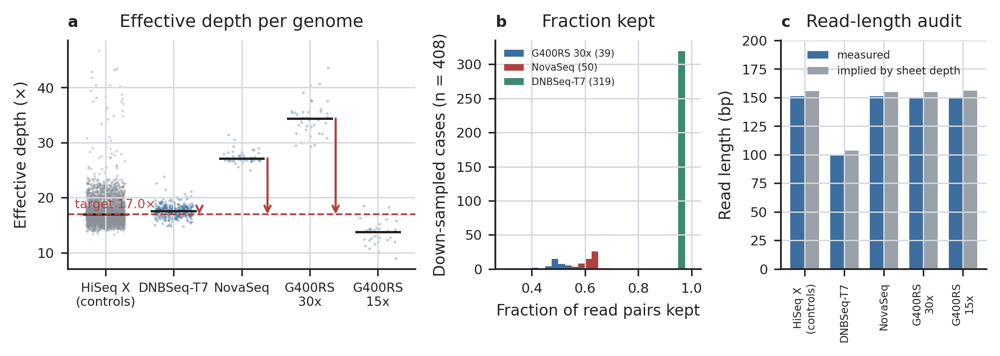
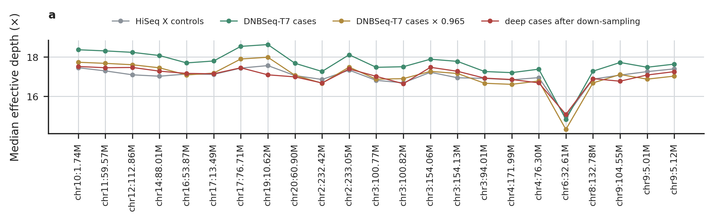

# Depth and the down-sampling target

Figures of `check/platform_depth`, family `01.depth`. Every number drawn is read from the result tables (docs/OUTPUTS.md); `<name>.stats.json` holds the values each figure was drawn from.

## depth_platforms

a, effective depth (MQ ≥ 20, BQ ≥ 10, duplicates excluded) of every full-mainland genome by platform, median as a bar; the dashed line is the target D*, the median of the HiSeq X controls; arrows take every down-sampled platform's median to it (all case platforms but DNBseq-G400RS 15x). b, the fraction of read pairs each down-sampled case keeps: the deep cases each to D*, the DNBSeq-T7 cases one platform fraction. c, the read-length audit: measured read length against the length the info sheet's Observed_Depth implies (DNBSeq-T7 is a 100 bp library).

Drawn from: `{"target_depth": 16.9897, "downsampled_cases": 408, "by_platform": {"DNBSeq-T7 30x": 319, "NovaSeq 30x": 50, "DNBSeq-G400RS 30x": 39}, "platform_median_depth": {"HiSeqX 15x": 16.9897, "DNBSeq-T7 30x": 17.6007, "NovaSeq 30x": 27.1488, "DNBSeq-G400RS 30x": 34.3789, "DNBseq-G400RS 15x": 13.7651}}`

## depth_local

Median effective depth at every calling interval: HiSeq X controls, DNBSeq-T7 cases before and after their platform fraction, and the deep cases after down-sampling (their depth there × their fraction).

Drawn from: `{"ratio_deep_after_over_controls": {"count": 23.0, "mean": 1.0008000000000001, "std": 0.012087220900228046, "min": 0.9732, "25%": 0.994, "50%": 1.0014, "75%": 1.0084, "max": 1.0219}, "ratio_t7_after_over_controls": {"count": 23.0, "mean": 1.0017460036820627, "std": 0.018601392741679035, "min": 0.9561703591121449, "25%": 0.9885674834632889, "50%": 1.0026902605787542, "75%": 1.0144380274642817, "max`
