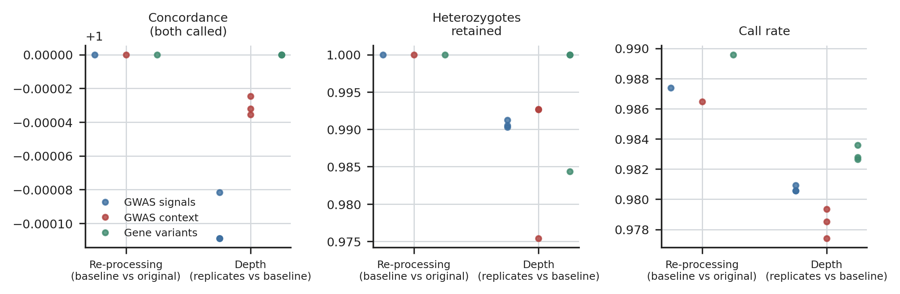
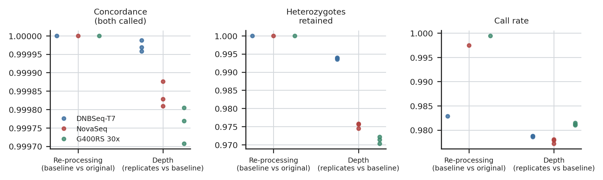
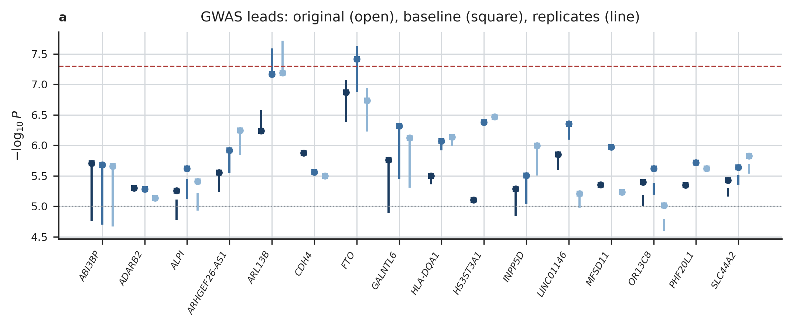
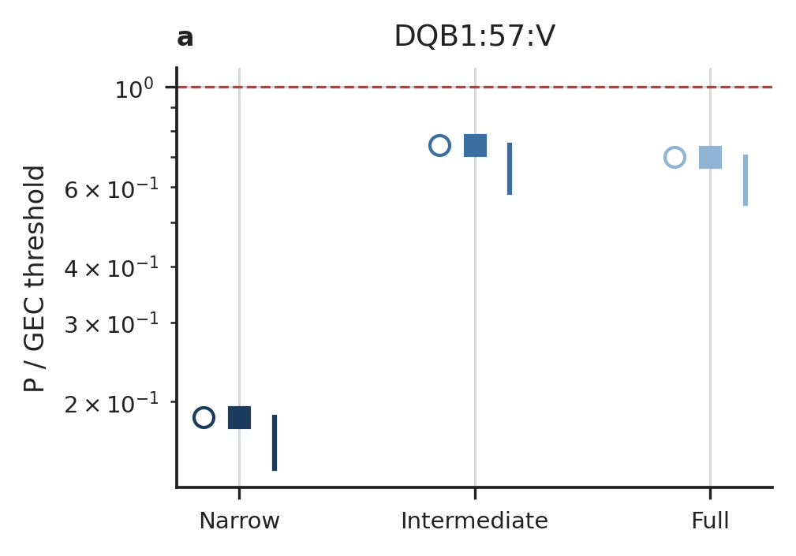

# Down-sampling: genotypes and signals

Figures of `check/platform_depth`, family `02.downsampling`. Every number drawn is read from the result tables (docs/OUTPUTS.md); `<name>.stats.json` holds the values each figure was drawn from.

## concordance

Genotype concordance among genotypes called in both, heterozygotes retained and call rate of the down-sampled cases: re-processing (baseline vs original) and the depth effect (each replicate vs baseline), by variant class.

Drawn from: `{"rows": 84}`

## concordance_platforms

The same metrics over every fixed site, per platform of the down-sampled cases (DNBSeq-T7, NovaSeq, DNBSeq-G400RS 30x).

Drawn from: `{"recall_vs_original:DNBSeq-T7 30x:concordance": [1.0, 1.0], "recall_vs_original:NovaSeq 30x:concordance": [1.0, 1.0], "recall_vs_original:DNBSeq-G400RS 30x:concordance": [1.0, 1.0], "replicate_vs_baseline:DNBSeq-T7 30x:concordance": [0.9999581463621716, 0.999988040423369], "replicate_vs_baseline:NovaSeq 30x:concordance": [0.9998091020158828, 0.999875816743724], "replicate_vs_baseline:DNBSeq-G400R`

## gwas_leads

-log10 P of each locus lead per cohort: original genotypes (open), the f = 1 baseline (square) and the range over replicates (line); dotted 10^-5, dashed 5 × 10^-8.

Drawn from: `{"loci": 16}`

## hla_dqb1_57v

DQB1:57:V, P divided by the scan's GEC threshold (below 1 = significant): original, baseline, replicate range, per cohort.

Drawn from: `{}`
