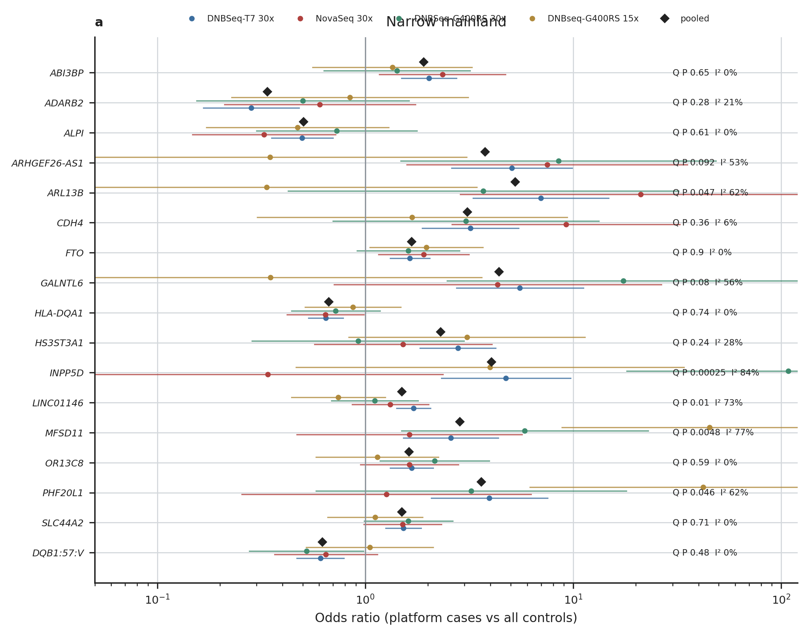
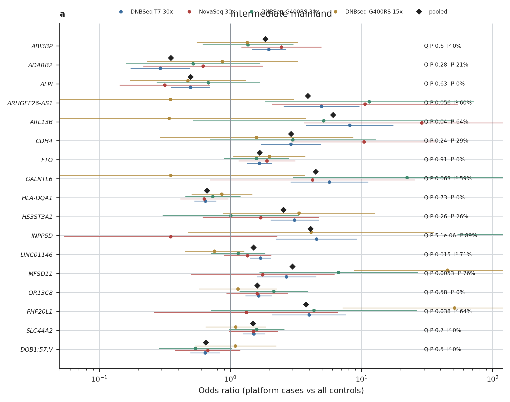
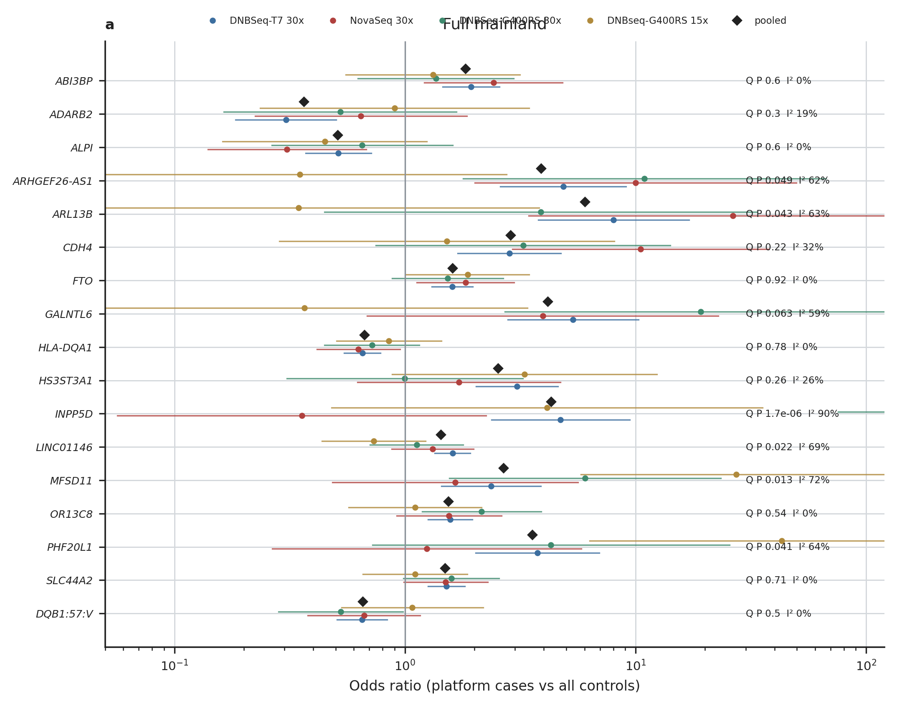

# Platform sensitivity

Figures of `check/platform_depth`, family `03.platform`. Every number drawn is read from the result tables (docs/OUTPUTS.md); `<name>.stats.json` holds the values each figure was drawn from.

## forest.narrow_mainland

Odds ratio of each GWAS lead and DQB1:57:V in each case-platform stratum (that platform's cases vs every control), the pooled estimate (diamond), and Q and I² across the strata; narrow mainland.

Drawn from: `{"markers": 17}`

## forest.intermediate_mainland

As above, intermediate mainland.

Drawn from: `{"markers": 17}`

## forest.full_mainland

As above, full mainland.

Drawn from: `{"markers": 17}`
