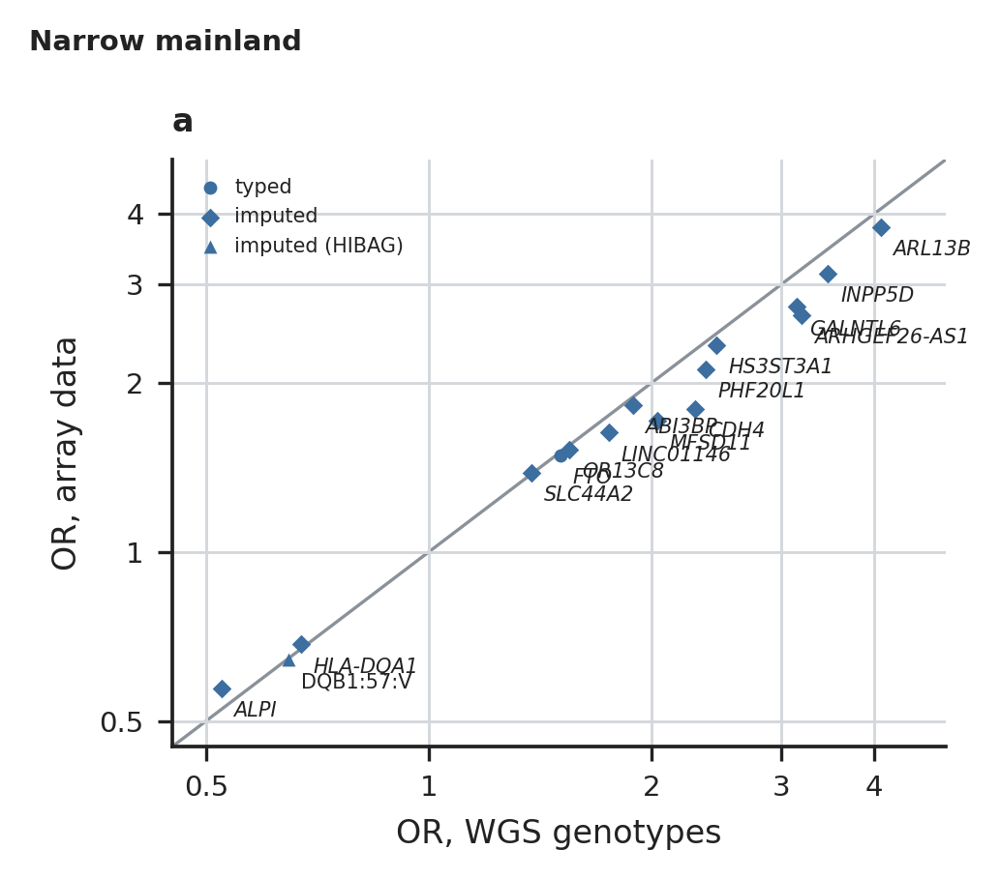
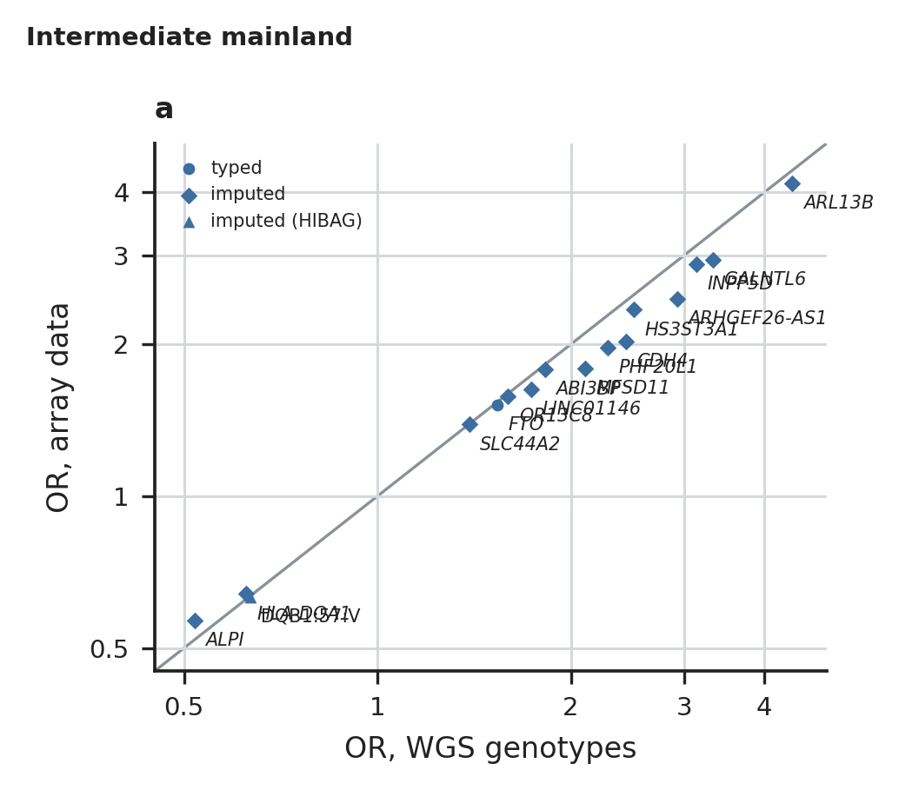
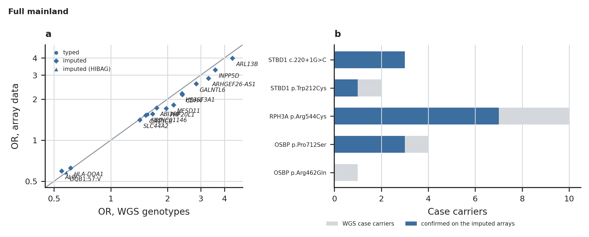

# SNP-array evidence, per cohort

Figures of `check/platform_depth`, family `04.array`. Every number drawn is read from the result tables (docs/OUTPUTS.md); `<name>.stats.json` holds the values each figure was drawn from.

## array_evidence.narrow_mainland

The unrelated narrow-mainland genomes with SNP arrays (DNBSeq-T7 cases on ASA24v1, HiSeq X controls on JSA24v1), WGS against the array data in the same people. a, OR on WGS against OR on the array data at one marker per signal: the lead typed, else imputed (R² ≥ 0.8; DQB1:57:V imputed with HIBAG), else an LD proxy (r² ≥ 0.8); cases and controls are read from the same data; the line is identity.

Drawn from: `{"association_rows": 16, "driver_rows": 0, "signals_by_verdict": {"consistent on arrays": 16, "not checkable": 1}}`

## array_evidence.intermediate_mainland

As above, intermediate mainland.

Drawn from: `{"association_rows": 16, "driver_rows": 0, "signals_by_verdict": {"consistent on arrays": 16, "not checkable": 1}}`

## array_evidence.full_mainland

As above, full mainland (the people of check/array_crosscheck; gate G10), with b, the driver variants of the gene sets (full mainland, which contains the other two cohorts): WGS case carriers and those the imputed arrays confirm (dosage ≥ 0.5); controls are in the imputation panel and not shown.

Drawn from: `{"association_rows": 16, "driver_rows": 5, "signals_by_verdict": {"consistent on arrays": 16, "carriers counted": 3, "not checkable": 2}}`
