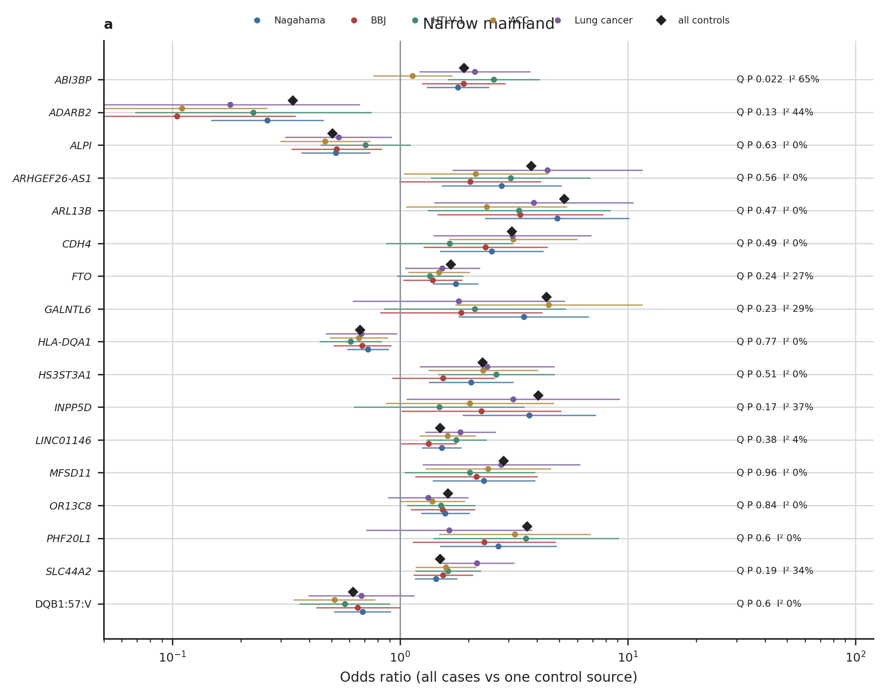
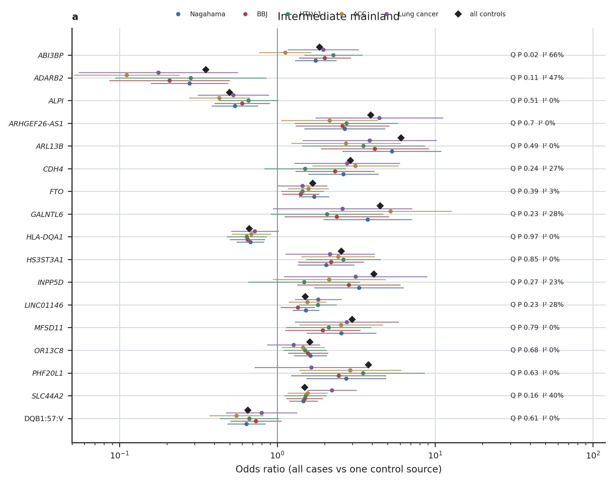
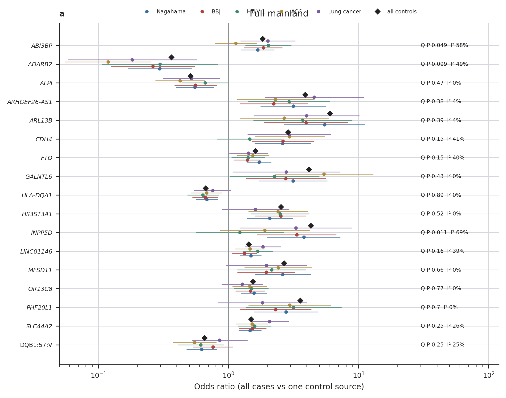

# Control sources

Figures of `check/platform_depth`, family `05.controls`. Every number drawn is read from the result tables (docs/OUTPUTS.md); `<name>.stats.json` holds the values each figure was drawn from.

## sources.narrow_mainland

Odds ratio of each GWAS lead and DQB1:57:V with every case against the controls of one source (Nagahama, BBJ, HTLV-1, ACC, lung cancer; each with its own SAIGE null model), all controls (diamond), and Q and I² across the sources (they share the cases); narrow mainland.

Drawn from: `{"markers": 17, "sources": ["nagahama", "bbj", "htlv1", "acc", "lungca"]}`

## sources.intermediate_mainland

As above, intermediate mainland.

Drawn from: `{"markers": 17, "sources": ["nagahama", "bbj", "htlv1", "acc", "lungca"]}`

## sources.full_mainland

As above, full mainland.

Drawn from: `{"markers": 17, "sources": ["nagahama", "bbj", "htlv1", "acc", "lungca"]}`
