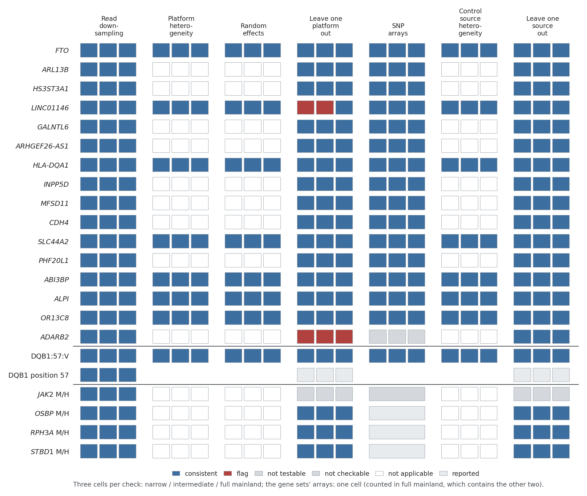
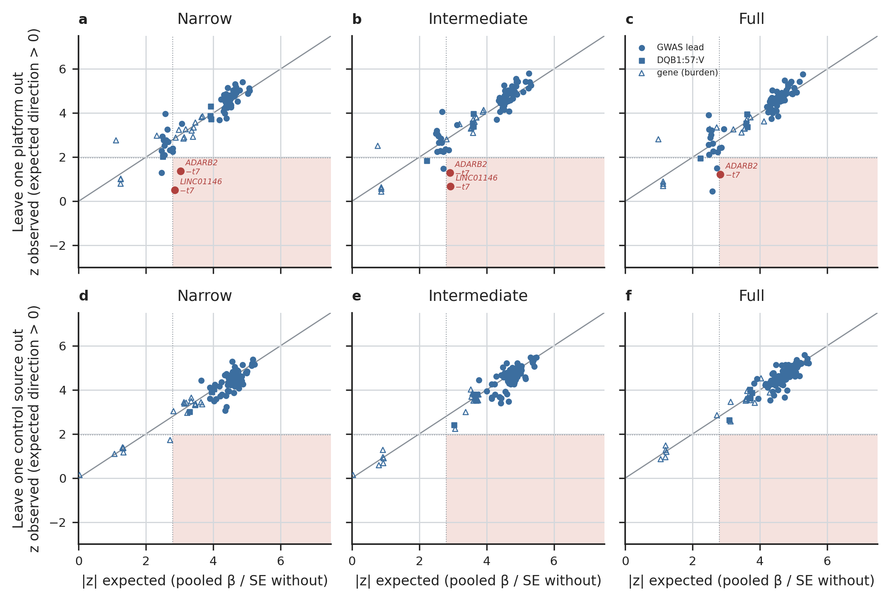
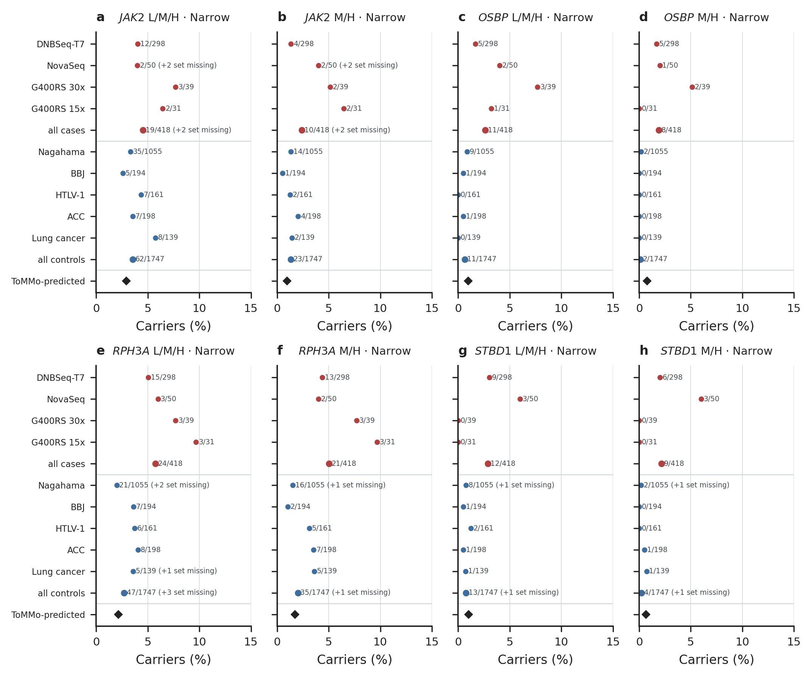
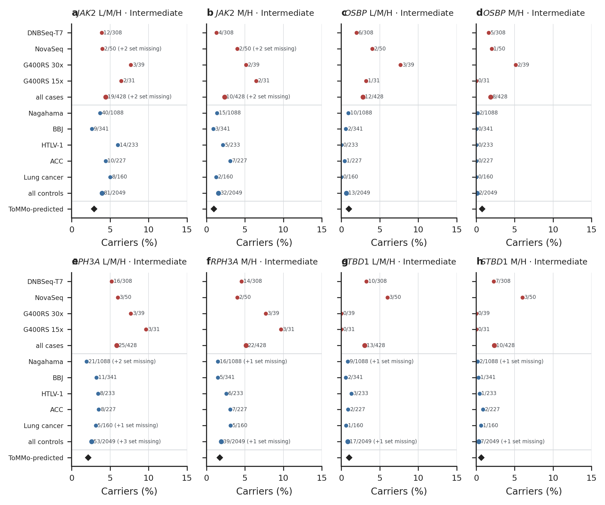
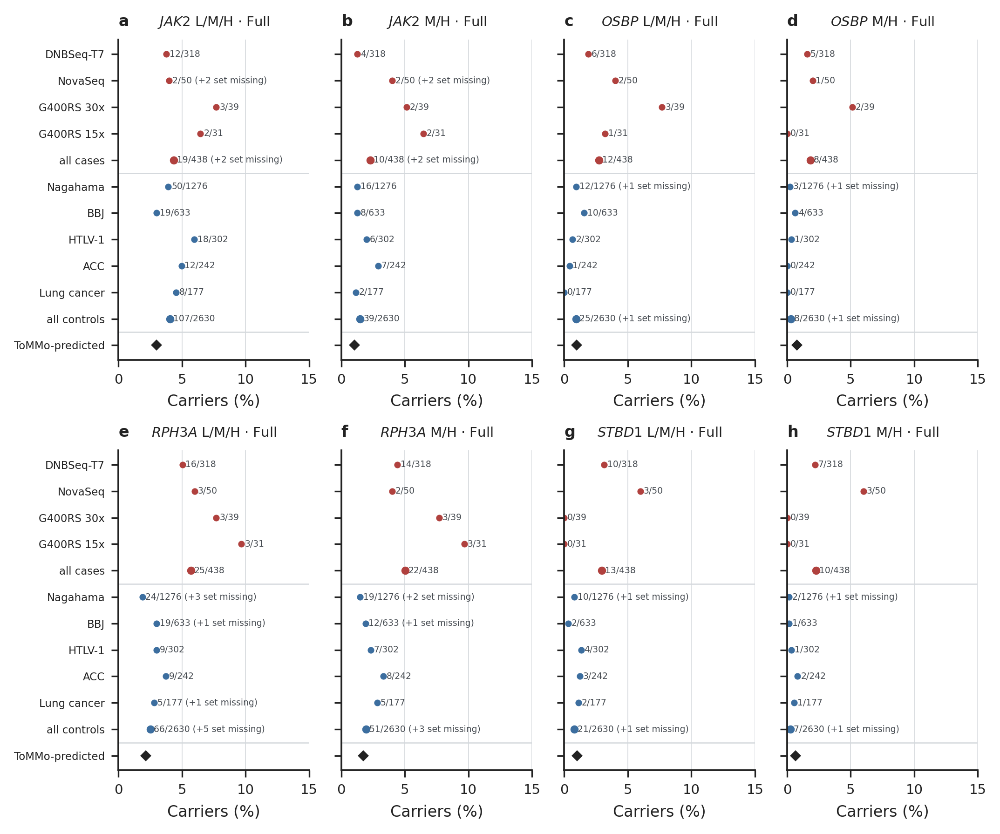
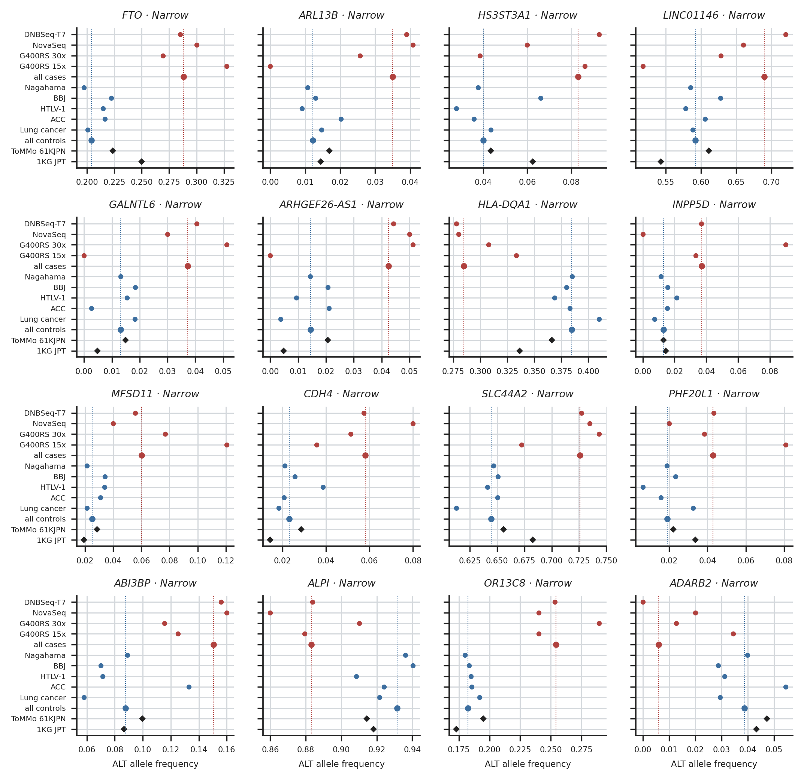
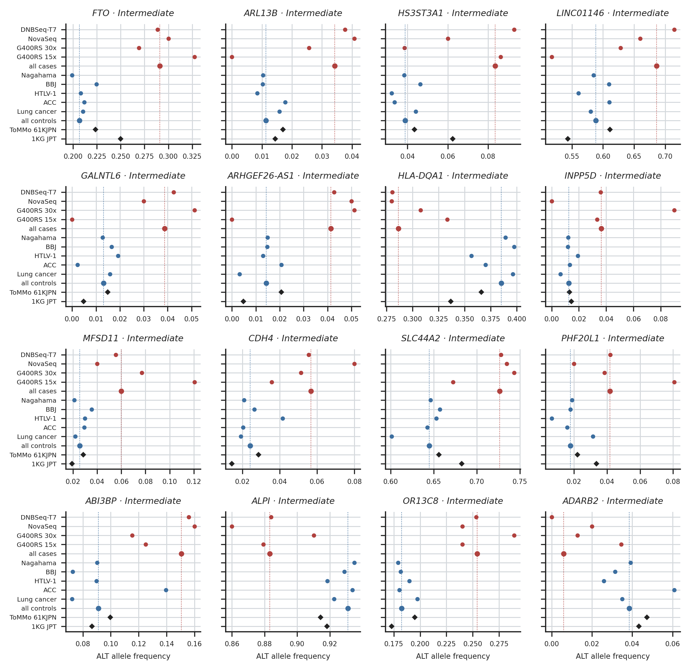
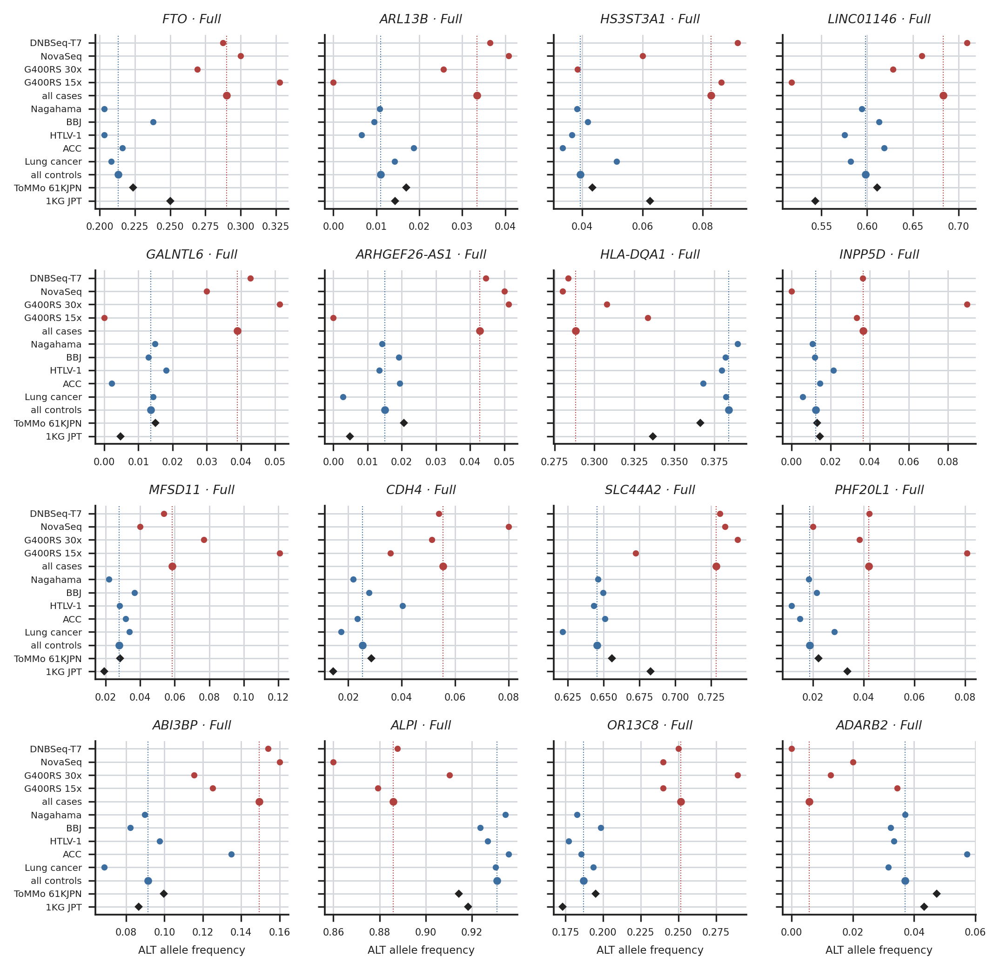

# The evidence matrix and the follow-up of its flags

Figures of `check/platform_depth`, family `06.evidence`. Every number drawn is read from the result tables (docs/OUTPUTS.md); `<name>.stats.json` holds the values each figure was drawn from.

## evidence_matrix

Every signal (rows: GWAS leads, DQB1:57:V, position DQB1 57, Tier 1–2 genes in their M/H sets, the main analysis) against every check (columns), read by the rules of 14.evidence/evidence.rules.tsv: blue consistent, red flag, grey not testable or not checkable, white not applicable. Three cells per check = narrow / intermediate / full mainland. A check flags a signal when its rule holds in any one cohort; nothing is removed.

Drawn from: `{"signals": 22, "cells": {"consistent": 301, "not applicable": 117, "flag": 5, "not checkable": 4, "reported": 9, "not testable": 6}}`

## z_observed_expected

Every leave-one-out estimate: z observed (sign set so that the pooled direction is positive) against |z| expected = pooled β / SE without the left-out group. a–c, leave one case platform out; d–f, leave one control source out; per cohort. The line is identity; the shaded corner (|z| expected ≥ 2.8, z observed < 1.96) is the flag rule. Genes use the CMC burden β.

Drawn from: `{"points": 567, "flagged": {"lopo:narrow_mainland": ["LINC01146 -t7", "ADARB2 -t7"], "lopo:intermediate_mainland": ["LINC01146 -t7", "ADARB2 -t7"], "lopo:full_mainland": ["ADARB2 -t7"]}}`

## gene_carriers.narrow_mainland

Tier 1–2 genes in their tiered sets, narrow mainland: carrier share per case platform and per control source (counts beside each point), the pooled groups, and the share ToMMo 61KJPN predicts from its allele frequencies (diamond). "set missing": genotypes the cohort filters set missing although the pre-QC record carries the ALT.

Drawn from: `{"JAK2:low_moderate_high:case | DNBSeq-T7 30x": 4.027, "JAK2:low_moderate_high:case | NovaSeq 30x": 4.0, "JAK2:low_moderate_high:case | DNBSeq-G400RS 30x": 7.692, "JAK2:low_moderate_high:case | DNBseq-G400RS 15x": 6.452, "JAK2:low_moderate_high:case | all": 4.545, "JAK2:low_moderate_high:control | nagahama": 3.318, "JAK2:low_moderate_high:control | bbj": 2.577, "JAK2:low_moderate_high:control | ht`

## gene_carriers.intermediate_mainland

As above, intermediate mainland.

Drawn from: `{"JAK2:low_moderate_high:case | DNBSeq-T7 30x": 3.896, "JAK2:low_moderate_high:case | NovaSeq 30x": 4.0, "JAK2:low_moderate_high:case | DNBSeq-G400RS 30x": 7.692, "JAK2:low_moderate_high:case | DNBseq-G400RS 15x": 6.452, "JAK2:low_moderate_high:case | all": 4.439, "JAK2:low_moderate_high:control | nagahama": 3.676, "JAK2:low_moderate_high:control | bbj": 2.639, "JAK2:low_moderate_high:control | ht`

## gene_carriers.full_mainland

As above, full mainland.

Drawn from: `{"JAK2:low_moderate_high:case | DNBSeq-T7 30x": 3.774, "JAK2:low_moderate_high:case | NovaSeq 30x": 4.0, "JAK2:low_moderate_high:case | DNBSeq-G400RS 30x": 7.692, "JAK2:low_moderate_high:case | DNBseq-G400RS 15x": 6.452, "JAK2:low_moderate_high:case | all": 4.338, "JAK2:low_moderate_high:control | nagahama": 3.918, "JAK2:low_moderate_high:control | bbj": 3.002, "JAK2:low_moderate_high:control | ht`

## lead_frequencies.narrow_mainland

GWAS leads, narrow mainland: ALT allele frequency per case platform and control source, the pooled groups (dotted lines: all cases red, all controls blue), ToMMo 61KJPN and 1KG JPT.

Drawn from: `{"FTO": {"cases": 0.2883, "controls": 0.2042}, "ARL13B": {"cases": 0.035, "controls": 0.0122}, "HS3ST3A1": {"cases": 0.0831, "controls": 0.04}, "LINC01146": {"cases": 0.6898, "controls": 0.5918}, "GALNTL6": {"cases": 0.0373, "controls": 0.0132}, "ARHGEF26-AS1": {"cases": 0.0425, "controls": 0.0145}, "HLA-DQA1": {"cases": 0.2847, "controls": 0.3847}, "INPP5D": {"cases": 0.0372, "controls": 0.013}, `

## lead_frequencies.intermediate_mainland

As above, intermediate mainland.

Drawn from: `{"FTO": {"cases": 0.291, "controls": 0.2066}, "ARL13B": {"cases": 0.0342, "controls": 0.0114}, "HS3ST3A1": {"cases": 0.0835, "controls": 0.0388}, "LINC01146": {"cases": 0.6865, "controls": 0.5884}, "GALNTL6": {"cases": 0.0387, "controls": 0.0132}, "ARHGEF26-AS1": {"cases": 0.0415, "controls": 0.0143}, "HLA-DQA1": {"cases": 0.2862, "controls": 0.3852}, "INPP5D": {"cases": 0.0364, "controls": 0.0125`

## lead_frequencies.full_mainland

As above, full mainland.

Drawn from: `{"FTO": {"cases": 0.29, "controls": 0.2131}, "ARL13B": {"cases": 0.0334, "controls": 0.011}, "HS3ST3A1": {"cases": 0.0828, "controls": 0.0394}, "LINC01146": {"cases": 0.6833, "controls": 0.5982}, "GALNTL6": {"cases": 0.039, "controls": 0.0136}, "ARHGEF26-AS1": {"cases": 0.0428, "controls": 0.015}, "HLA-DQA1": {"cases": 0.2884, "controls": 0.3841}, "INPP5D": {"cases": 0.0368, "controls": 0.0123}, "`

## v57_replicates

The deep cases whose DQB1:57:V dosage differs between any two arms (original typing, the f = 1 baseline, the replicates): the DQB1 call, the dosage and the HLA-HD confidence; red one V copy more than the baseline, blue one fewer. The deep cases belong to all three cohorts and their typings are the same in each, so the figure is drawn once.

Drawn from: `{"deep_cases_changed": 1, "arms": ["original", "baseline", "r01", "r02", "r03"], "identical_in_all_three_cohorts": true}`
