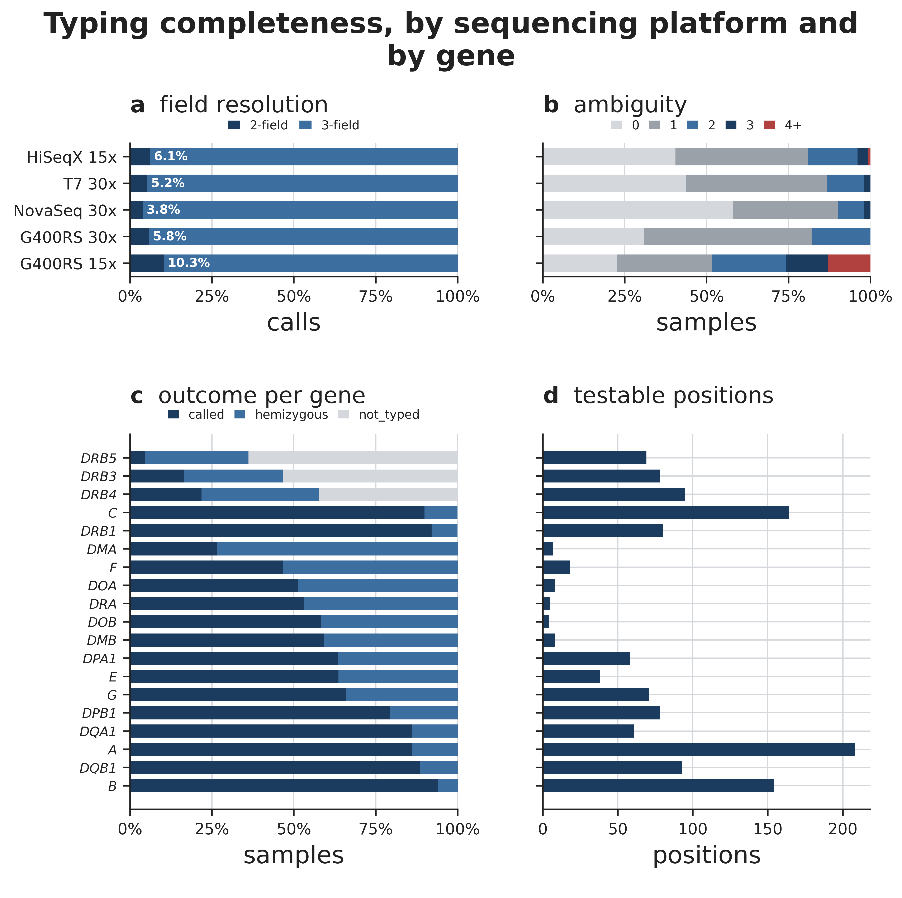
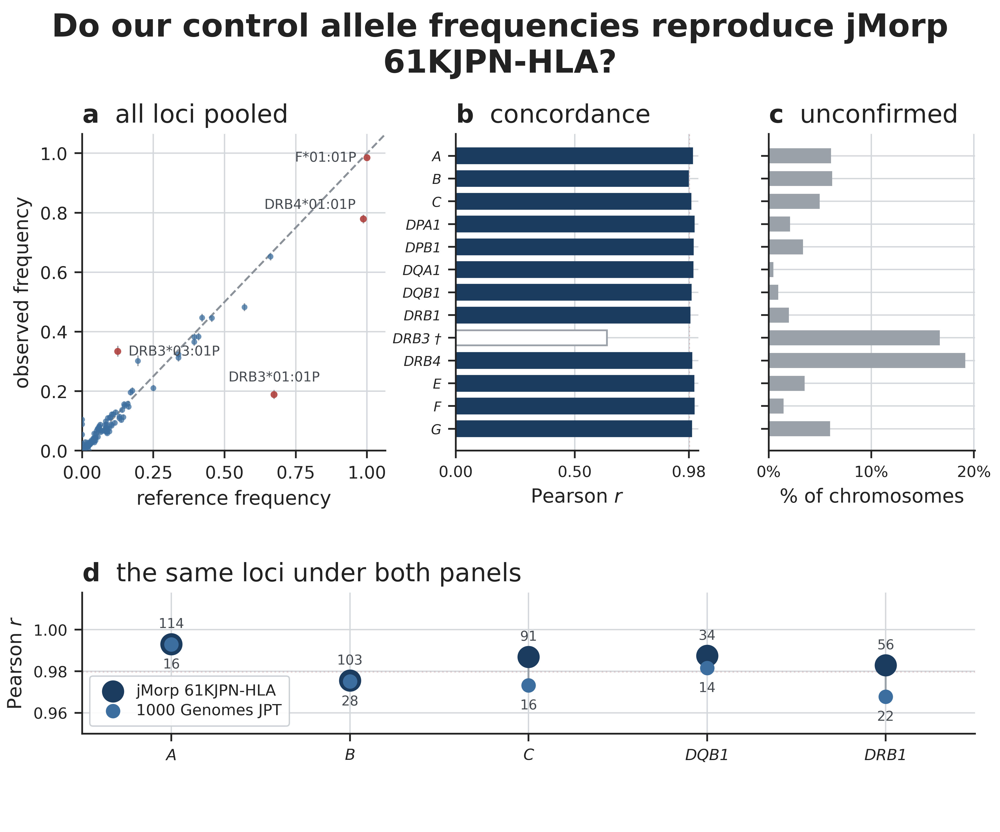
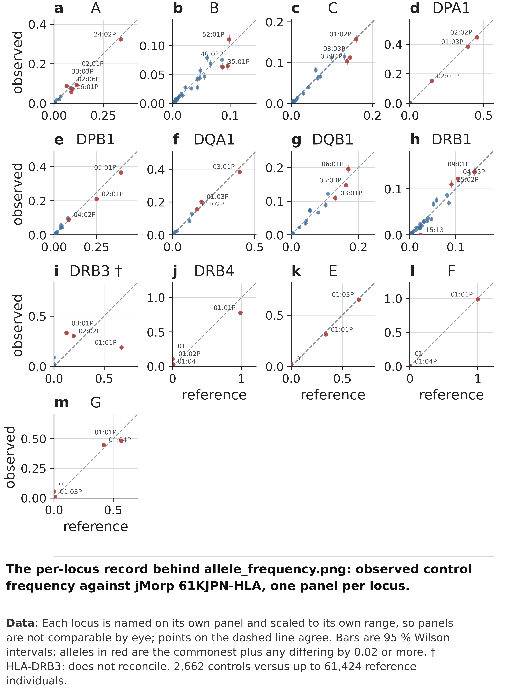
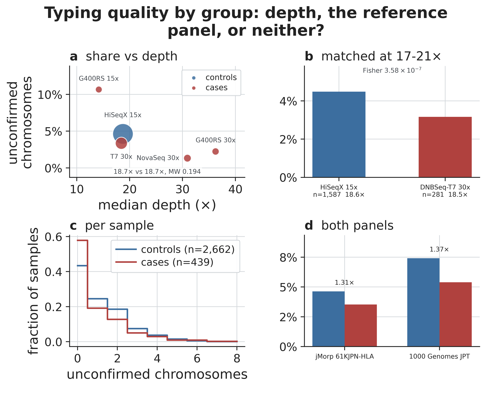

```{r setup}
#| include: false
# 本报告中的每一个数字都读自 results/_run_info/facts.json，没有任何一个是手写的。
# build_facts.py 从已发布的表格中推导出该文件。如果这里引用了流程并不产出的数字，
# 渲染会直接中止 —— 这正是这份报告用 .qmd 而不是 .docx 的原因，而且它已经拦下过
# 两个错误。
#
# 注意：中文段落一律写成一行，不要按列宽折行。Markdown 会用一个空格把折行拼接
# 起来，那个空格在英文里是词间隔、在中文里是错误 —— 上一版因此在正文里留下了
# 102 处不该有的空格。
library(jsonlite)
library(knitr)
R   <- normalizePath("../results")
F   <- fromJSON(file.path(R, "_run_info", "facts.json"))$rendered
f   <- function(k) { v <- F[[k]]; if (is.null(v)) stop("no such fact: ", k); v }
# 中文排版里百分号不留空格；这仍然是 facts.json 里的同一个值，只是去掉了那个空格。
fz  <- function(k) sub(" %", "%", f(k))
tsv <- function(p) read.delim(file.path(R, p), check.names = FALSE)
```

::: {#glance .callout-note}
## 一览

|  |  |
|---|---|
| **这是什么** | `r f("n_typed")` 个人的 HLA 基因型——`r f("n_typed_PH")` 例 CTEPH 病例，`r f("n_typed_AGP3K")` 例 AGP3K 对照 |
| **交付形式** | `allele_dosage.tsv`、`residue_dosage.tsv`、`residue_diplotype.tsv`、`allele_pgroup_map.tsv` |
| **失败数** | `r f("n_failed_gene_calls")` |
| **与已发表数据的吻合** | `r f("n_loci_comparable_jmorp")` 个可比位点中有 `r f("n_loci_concordant_jmorp")` 个达到 *r* ≥ `r f("r_concordant_threshold")` |
| **优先使用** | I 类残基（HLA-A、-B、-C） |
| **不要使用** | DRB3、DRB4、DRB5 的剂量——构造方式决定了这几列必然是错的 |
| **动手前必读** | @sec-confound，然后 @sec-support |
:::

::: {.callout-tip}
## 这份文档写给谁，以及怎么读

**写给完全没有接触过 HLA 的人。** @sec-primer 从零讲清楚相关的生物学背景和命名规则；其后各节都不假定你事先读过别的材料。

如果你平时就在做 HLA 分型，读 @sec-harmonise、@sec-confound 和 @sec-support 三节即可，其余可以跳过。如果你是来做关联分析的，恰恰是这三节会改变你的做法。

下面每一个数字，都是生成这个页面时从已发布的表格里读出来的，没有一个是手工填进去的。表格一变，页面重新生成，数字就跟着变；某个数字若在数据里找不到来源，生成过程会直接失败，而不会输出一个过时的值。点开灰色代码块可以看到某个数字究竟出自哪张表。
:::

# 这份文档是什么

交给你的是 `r f("n_typed")` 个人的 **HLA 基因型**——`r f("n_typed_PH")` 例 CTEPH 病例和 `r f("n_typed_AGP3K")` 例 AGP3K 对照——供你检验其中是否有与疾病相关的位点。**CTEPH** 指慢性血栓栓塞性肺高血压，也就是本研究针对的疾病；**AGP3K** 则是对照样本所来自的那个日本人队列。

这份文档只有一个目的：让你**不必盲目相信这批数据**也能用它。它交代了这批数据测的是什么、完整到什么程度、与已发表数据吻合得如何，以及最要紧的一点——一旦不加注意，它会在哪两个具体的地方误导你。

# HLA 五分钟入门 {#sec-primer}

如果你已经知道 `A*24:02` 是什么意思，这一节可以跳过。后面各节都建立在这一节之上——基因名怎么读、一次分型结果“缺失”的两种不同含义，以及为什么 DRB3 会反复出现。

## 这些基因在哪里

**HLA**（人类白细胞抗原）这一组基因并不散落在基因组各处，它们聚在 6 号染色体短臂的 6p21.3 带上，构成一个叫 **MHC**（主要组织相容性复合体）的区域，长约三到四个兆碱基，是人类基因组中基因密度最高的地段之一。MHC 是这个区域在各个物种中的通名，人类的那一份则叫 HLA。

沿染色体方向，这个区域习惯上分成三段来读。从着丝粒一侧起，先是 **II 类**基因（DP、DM、DO、DQ、DR），接着是一段 **III 类**区——它一个 HLA 基因也没有，却密集排布着补体、TNF 等其他免疫基因——再往后才是 **I 类**基因：先 B 和 C，然后 E，然后 A，最后是靠近端粒的非经典基因 G 和 F。III 类区在本文档里之所以值得一提，只因为它夹在另外两段中间，并且和它们一起被遗传。

本次交付对该区域的 `r f("n_genes_typed")` 个基因做了分型，其中 `r f("n_genes_with_residues")` 个进一步转成了氨基酸残基。两者之差不是质量筛选的结果：剩下的都是假基因——DRB2、DRB6 至 DRB9、DPA2，以及 I 类假基因 H、J、K、L、T、V、W、Y——一个不产生蛋白的基因，IPD-IMGT 自然也不会发布它的蛋白比对。

### 6 号染色体你有两条，而这正是本文档计数的单位

父母各给你一条，所以这个区域里的**每一个基因你都有两份拷贝**，而两份拷贝上的等位基因可以不一样——这就是所谓杂合。

从 @sec-completeness 开始，本文档里的每一个计数都是按**染色体拷贝**算的，不是按人算。因此 `r f("n_typed_AGP3K")` 个对照，在一个人人都分型成功的位点上，贡献的是这个数的两倍。所以文中出现的几千条“对照染色体”，并不是几千条不同的染色体，而是同一批人被数了两遍。频率也只能这样算：一个人携带某个等位基因可能是 0 份、1 份或 2 份，按人头数就把这个区别丢掉了。

这也解释了一个乍看不合理的数字。DRB3、DRB4、DRB5 在很多拷贝上**根本不存在**（见本章后面），所以它们的分母不是全部拷贝——DRB3 只在 `r fz("frac_chr_ctrl_not_comparable_jmorp")` 的对照染色体上被分型出来，只有真正携带这个基因的拷贝才计入。@sec-drb3 讲的正是这个差别。

## I 类和 II 类做同一件事，只是针对不同的威胁

一个 HLA 蛋白把另一个蛋白的一小段——一个**肽段**——夹在它外表面的凹槽里展示出来，好让经过的 T 细胞查验这个细胞里装了什么。它的功能就是这一件事。两个类别的差别在于：肽段从哪里来、由哪些细胞来展示、以及谁在看。

| | I 类 | II 类 |
|---|---|---|
| 经典基因 | HLA-A、-B、-C | HLA-DR、-DQ、-DP |
| 分子怎么搭起来 | 一条可变的 α 链，加上 β2 微球蛋白这个恒定搭档，后者的基因根本不在 MHC 里 | 两条链都编码在这里：DRA + DRB1/3/4/5、DQA1 + DQB1、DPA1 + DPB1 |
| 由谁展示 | 每一个有核细胞 | 抗原呈递细胞——树突状细胞、巨噬细胞、B 细胞、胸腺上皮 |
| 肽段来自 | 细胞**内部**合成的蛋白：自身的、病毒的、肿瘤的 | 从**外部**摄入、在内体中被切碎的蛋白 |
| 肽段形状 | 较短，凹槽两端封闭 | 较长，凹槽两端开放 |
| 由谁查验 | CD8 T 细胞 | CD4 T 细胞 |
| 认出之后会发生什么 | 杀掉这个细胞 | 提供帮助——产生抗体、释放细胞因子、辅助其他 T 细胞 |

这里分型的基因中有四个属于 II 类，却什么也不展示：**DMA、DMB、DOA、DOB** 编码的是给 II 类分子装载和编辑肽段的机器，而不是分子本身。它们几乎不发生变异，所以在 @fig-qc (d) 里贡献的可检验位点也少得可怜。**DRA** 同理：DR 的 α 链几乎不变，DR 的变异因而基本都落在 β 链上——也就是 DRB1 和下面要说的 DRB3/4/5。

I 类里的 **HLA-E、-F、-G** 被称为*非经典*基因。它们的多态性远不如 A、B、C，各自承担专门的任务：E 向自然杀伤（NK）细胞汇报经典 I 类分子的供应是否正常，G 主要表达在母胎界面。它们在这里被分型，对判断分型质量也有用，但一般不指望在它们身上找到经典的疾病关联。

## 为什么这里是基因组中变异最丰富的区域

一个 HLA 分子能夹住哪些肽段，取决于它凹槽的形状，而凹槽是由沿槽排列的少数几个氨基酸搭出来的。如果一个群体里所有人的凹槽都一样，那么只要出现一种病原体、它的肽段恰好这个凹槽夹不住，整个群体就可能被清空。于是选择压力奖励的是**和邻居不一样**，结果就是这个位点积累了数以万计的已知版本，而且常见的那些能在相当高的频率上维持很久，不会随随便便漂移掉。

由此可以引出两点，它们贯穿本文档其余部分。其一，这里的变异是**集中的**：它扎堆在构成凹槽的那几个外显子上，基因的其余部分反而相当安静。其二，正因为这些变异改变了免疫系统看得见什么，HLA 与疾病的关联比基因组中任何其他区域都多——自身免疫、感染、移植排斥、药物超敏。只要一种疾病带有免疫成分，HLA 就值得一测。

## MHC 是成段遗传的

MHC 大部分区段的重组受到抑制，因此相邻基因上的等位基因并不独立遗传。它们成组地一起传下去，这样的固定组合叫**单倍型**，出现频率远高于随机组合所能解释的水平；它在统计上的影子就是**连锁不平衡**：知道一个人的 HLA-B 等位基因，HLA-C 也就知道了大半，往往连 DRB1 都能猜个八九不离十。有些片段长达数个兆碱基，且带有明显的群体特异性——日本人群中 `A*24:02`、`C*12:02`、`B*52:01`、`DRB1*15:02`、`DQB1*06:01` 连在一起的那条单倍型就是众所周知的例子。

::: {.callout-note}
## 这一点会怎样影响你解读结果

在没有做额外工作之前，一个 HLA 关联信号说的是**一整段**，而不是某一个基因。DQB1 上的信号，可能是旁边的 DRB1 带出来的，也可能来自夹在两者之间的某个 III 类基因。有两个后果是实打实的：**光靠关联统计量无法把信号定位到单个基因**；本次交付的 `r f("n_residue_columns")` 个残基列，远远不等于 `r f("n_residue_columns")` 个独立检验。通常的下一步是条件分析——把最强的信号固定住再重新拟合——但也要老实承认，它很少能把紧挨着的邻居干净地分开。
:::

## 分型是一道匹配题，不是读一个碱基

对一个普通变异，你读一个位置，报出两个字母中的一个。HLA 不是这样。这些基因的版本太多，值得问的不是“这个位置上是哪个字母”，而是**“这是这个基因已知的几千上万个版本中的哪一个？”**——而且你有两个，父母各给一个。

所以分型是一道*匹配*题：把 HLA 区域的读段取出来，拿去和一份收录了所有人提交过的版本的目录比对，判断哪一对目录条目最能解释这些读段。这份目录就是 **IPD-IMGT/HLA**，它既给等位基因命名，也发布它们的序列；本次运行用的是 `r f("imgt_release")` 版，并且在我们自己的磁盘上固定成了一份不动的副本。固定这一步很要紧：公开目录一年要改好几次，等位基因会增加字段，偶尔还会改名，而一份会在研究途中变动的参考，就不成其为参考。

匹配还有一个性质必须挑明，因为 @sec-confound 正建立在它之上：**目录里没有的版本，是不可能被报出来的。** 一个真正的新等位基因永远不会被标成“新”，它的读段会被派给目录里最接近的那个邻居。

## 这里说的“一次分型结果”是什么，以及短读长为什么难

**一次分型结果**，指的是在一个人的一个基因上，最能解释其读段的那一对目录等位基因，由 HLA-HD `r f("hlahd_version")` 产出。它不是碱基判读，也不附带任何单次概率值。有三件事让它在短读长全基因组数据上很难做对。

区分两个等位基因的那些差异沿基因分散排列，间距通常超过一条读段或一个读段对所能跨越的范围，因此哪个差异落在哪条染色体上只能靠推断，而不是直接看到。参考基因组里每个 HLA 基因只放了**某一个任意选定的版本**，于是来自差异较大的等位基因的读段会大量错配，或者比对到别处、或者哪儿也去不了——这也正是本次交付在取读段时，除了 6 号染色体本身，还把参考中所有 alt 片段和 HLA 专用片段一并纳入的原因。再者，这些基因彼此长得像：DRB1 与 DRB3/4/5 是近旁系同源，A、B、C 及紧挨着它们的 I 类假基因也是，一个基因的读段很容易被另一个吸引过去。

当有好几对目录条目同样符合读段时，程序会如实报告，本数据集中共有 `r f("n_ambiguous_gene_calls")` 例这样的**歧义**结果，总量是 `r f("n_gene_calls")` 个（样本、基因）分型。这个标记是该方法所能给出的、最接近置信度的东西。**`失败（failed）` 才是真正代表出了问题的标签，而它在这批数据中出现了 `r f("n_failed_gene_calls")` 次。**

## 怎么读一个等位基因名

HLA 基因的一个版本叫一个**等位基因**，它的名字是一串有结构的地址，不是随手取的标签：

```
A * 24 : 02 : 01 : 03
│   │    │    │    └── 第 4 字段：蛋白编码区之外的差异
│   │    │    └─────── 第 3 字段：改变 DNA 但不改变蛋白的差异
│   │    └──────────── 第 2 字段：会改变蛋白的差异
│   └───────────────── 第 1 字段：大类，大致对应旧的血清型
└───────────────────── 基因名，也叫位点

A * 24 : 09 N
            └── 表达后缀：这个等位基因会被转录，但没有蛋白到得了细胞
                表面，所以这条染色体在 HLA-A 上什么也展示不了——哪怕
                名字看上去和普通的 A*24 没有两样
```

字段按重要性从高到低排列，每个等位基因至少有前两个字段。末尾那个可选的字母叫**表达后缀**，它的效力压过左边的一切：

| 后缀 | 含义 | 为什么要紧 |
|---|---|---|
| `N` | **空（null）**——细胞表面没有蛋白 | 不管名字看上去多正常，这条染色体在该基因上功能性地是空的 |
| `L` | 表面表达量低 | 存在，但表达水平未必能当成完整的一份拷贝来用 |
| `S` | 分泌型——蛋白存在，但是可溶的，不在膜上 | 同样要打折扣，只是原因不同 |
| `Q` | 表达情况存疑，尚未确证 | 按“未定”处理，不要当成上面任何一种 |

要记住的是 `N`。@sec-harmonise 里讨论的 DRB4 正是靠它：参考面板用一个空等位基因来表示“这条单倍型没有能用的 DRB4”。另外请注意，**本次交付的名字一律不带后缀**——我们的分型程序不写它（见 @sec-harmonise）——所以 `allele_dosage.tsv` 里没有任何一列会自报“我是空的”。

## 为什么本次交付停在两个字段

**第 2 字段正是蛋白发生改变的地方**，也就是最后一个会改变分子展示能力的字段。再往后要么在蛋白层面完全沉默（第 3 字段），要么根本不在编码序列里（第 4 字段）。所以本次交付报到 `A*24:02` 就停下。

这是一个选择，但称不上艰难。更深的字段要靠内含子和非翻译区的序列来判定，而短读长数据对这些区段的覆盖并不均匀，因此它们是一次分型结果中最不可靠的部分：本数据集中任何地方达到的最深分辨率是第 `r f("max_field_depth_seen")` 字段，带第 4 字段的分型结果有 `r f("n_field4_calls")` 例。何况已发表的群体数据同样只写到两个字段，报得更深也没有可比对的东西。

## 抗原识别域

HLA 蛋白并不是每一部分都在做展示。真正围成凹槽、直接接触肽段的那一段，叫**抗原识别域**（ARD）：I 类是 α1 与 α2 两段，II 类是 α1 或 β1 段；换算成 DNA，I 类基因是第 2、3 外显子，II 类基因是第 2 外显子。

要问两个等位基因在功能上是不是同一回事，ARD 是天然的判断单位，IPD-IMGT 也正是这样用它的：**在整个 ARD 上蛋白序列完全相同**的等位基因被收进同一个 **P 组**，用组内编号最小的成员加一个 `P` 来命名。`DRB3*01:01P` 不是一个等位基因，而是一组只在凹槽之外互有差异的等位基因。参考面板经常按这个分辨率发布数据，@sec-harmonise 讲的就是这件事。交给你的基因型没有做 P 组合并。

## 什么是残基，为什么它往往是更好的检验对象

**残基**指蛋白某一个位置上的一个氨基酸。由于同一个 `基因:位置:氨基酸` 组合会被许多不同的等位基因共享，残基检验问的是一个比等位基因检验更稳健的问题：

| | 等位基因检验 | 残基检验 |
|---|---|---|
| 你回归的是什么 | `allele_dosage.tsv` 的一列，如 `DRB1*15:01` | `residue_dosage.tsv` 的一列，如 `DRB1:11:P` |
| 它问的问题 | “携带 `DRB1*15:01` 的人更容易得病吗？” | “DRB1 第 11 位是脯氨酸的人更容易得病吗？” |
| 检验数量 | 多，且大多罕见 | 少，且大多常见 |
| 若某个罕见等位基因分错了 | 这个等位基因的结果就是错的 | 通常不受影响——被混淆的那个等位基因在多数位置上是同一个氨基酸 |
| 它做不到什么 |——| 指认是哪个等位基因；一个残基为许多等位基因所共有 |

具体地说：本队列共携带 `r f("n_alleles_carried")` 个不同的两字段等位基因，而它们底下的蛋白变异归结起来只有 `r f("n_polymorphic_positions")` 个会变的氨基酸位置。同样的证据，装在更少也更常见的列里。

位置编号沿用 IPD-IMGT 的编号方式，以成熟蛋白为准，所以你会看到 `A:-21:M` 这样的负数位置——它们落在加工过程中被切掉的信号肽上。两套矩阵都会交付；它们结论不一致时该信哪一个，见 @sec-support。

## 你可能根本没有的基因：DRB3、DRB4 和 DRB5

大多数基因有两份拷贝，DR 区却不是这样。每条单倍型都带 DRA 和 DRB1，但它是否还带**第二个**表达的 β 链基因、带的是哪一个，取决于它所携带的 DRB1 等位基因。这些单倍型组各有各的名字：

| 单倍型组 | 第二个 β 基因 | 与哪些 DRB1 大类同行 |
|---|---|---|
| DR51 | DRB5 | `DRB1*15`、`DRB1*16` |
| DR52 | DRB3 | `DRB1*03`、`*11`、`*12`、`*13`、`*14` |
| DR53 | DRB4 | `DRB1*04`、`*07`、`*09` |
|——| 没有 | `DRB1*01`、`*08`、`*10` |

所以一个人在 DRB3、DRB4、DRB5 上确实可能**有两份、有一份，或者一份都没有**，而本队列中每个基因能被找到的比例也正反映了这一点：DRB3 为 `r f("call_rate_DRB3")`，DRB4 为 `r f("call_rate_DRB4")`，DRB5 为 `r f("call_rate_DRB5")`。这是生物学事实，不是测序失败，它也带来了你会在 @sec-completeness 看到的两个结果标签：

* **半合子（hemizygous）**——一份存在，另一份是真的不存在。
* **未分型（not_typed）**——该基因在这个人的单倍型上根本不存在。

两者都不代表出了问题。但它确实意味着：这三个基因的剂量列不能按其余基因的方式来读；DRB3 与参考的比较会失效（见 @sec-drb3）；@sec-support 让你不要使用的，也正是这三个基因。

# 你拿到的是什么

四张表，都以 `sample_id` 为键，覆盖的都是同一批 **`r f("n_typed")`** 个人。

| 文件 | 形状 | 一列代表 | 一个单元格是 |
|---|---|---|---|
| `04.residues/allele_dosage.tsv` | `r f("n_typed")` × `r f("n_allele_columns")` | 一个两字段等位基因，如 `A*24:02` | 携带几份（0、1、2） |
| `04.residues/residue_dosage.tsv` | `r f("n_typed")` × `r f("n_residue_columns")` | 一个 `基因:位置:氨基酸` | 携带几份（0、1、2） |
| `04.residues/residue_diplotype.tsv` | `r f("n_typed")` × `r f("n_diplotype_columns")` | 一个 `基因:位置` | 该位置上的一对氨基酸（不分先后） |
| `05.qc/allele_pgroup_map.tsv` | 每个等位基因一行 | — | 已发表的日本人参考面板是否收录了这个等位基因 |

前两张是你要拿去做回归的。第四张是一张安全检查表，检验罕见等位基因之前先查它——这是 @sec-confound 的要求。

::: {.callout-warning}
## `sample_id` 必须按字符串读取

`r f("n_typed")` 个样本 id 中有 `r f("n_leading_zero_ids")` 个以 0 开头。`pandas.read_csv` 如果不指定 `dtype`，会把这一列读成整数，悄悄抹掉这些前导零；随后的内连接会返回 `r f("n_after_numeric_join")` 行而不是 `r f("n_typed")` 行，**既不报错也不警告**。

```python
pd.read_csv(path, sep='\t', dtype={'sample_id': str})
```
:::

# 这些人是谁 {#sec-people}

样本依次经过三层过滤，而这三层**不是同一种性质的决定**。

```{r chain}
#| echo: true
data.frame(
  步骤 = c("1. 属于 v6 研究队列", "2. 通过测序质量控制", "3. **落在本土祖先聚类内**"),
  筛选依据 = c("是否属于本研究", "全基因组数据是否可用", "**是否共享同一祖先背景**"),
  剩余 = c(f("n_v6_flagged"), f("n_qc_pass"), f("n_typed")),
  移除 = c("—", f("n_dropped_sample_qc"), f("n_dropped_ancestry")),
  check.names = FALSE
) |> kable()
```

第 2 步是**质量**决定：上游剔除了 `r f("n_dropped_sample_qc")` 个全基因组杂合度异常的人。对 HLA 分型来说，恰恰是这批样本最难干净地解析出一个基因的两个版本，因此沿用上游的决定是对的。

第 3 步是**祖先**决定，也是值得多花点时间理解的一步，因为 @sec-confound 正建立在它之上。HLA 分型唯一可用的外部检验是——*“我们分型得到的等位基因，在已发表的日本人参考面板里出现过吗？”*。一个对照如果祖先背景与该面板不同，那么通不过这个检验的原因就与分型质量毫无关系。事先把队列限制住，等于从一开始就排除了这种解释。

第 3 步移除的 `r f("n_dropped_ancestry")` 个人**同样已经分型，结果也没有删掉**——都保存在 `results/_superseded.3569/` 下。将来若要扩展到更大的样本集，代价只是重跑一个收集脚本，而不必重跑分型。

# 分型是怎么做的

* **读段**取自 6 号染色体整个 HLA 区域，外加参考基因组中所有 alternate 和 HLA 专属 contig——HLA 的变异实在太大，来自罕见版本的读段根本比对不到那唯一一份“标准”拷贝上。
* **HLA-HD `r f("hlahd_version")`** 把这些读段比对到**钉死**的那份 IPD-IMGT/HLA `r f("imgt_release")` 目录副本上。“钉死”是指我们自己磁盘上的一份固定副本：公开目录每年更新数次，而参考若会在研究途中变动，就算不上参考。
* 共分型 **`r f("n_genes_typed")` 个基因**。IPD-IMGT 为其中 **`r f("n_genes_with_residues")`** 个发布了蛋白比对，也只有这些基因能转换成残基。
* **残基直接取自 IMGT 自己发布的比对**，从不自行重算，所以我们说的“DRB1 第 11 位”和别人说的是同一个位置。
* 该比对的 `r f("n_reference_positions")` 个位置中，**`r f("n_polymorphic_positions")` 个在本队列中确实存在变异**，交付的就是这些位置。一个位置上所有人的氨基酸都相同，就不携带任何信息。

# 完整度如何 {#sec-completeness}

**整批数据中共有 `r f("n_failed_gene_calls")` 例（样本、基因）失败。** 这不是运气好。分型程序即使内部崩溃也会以成功状态退出，所以每份结果都在分型任务**内部**再校验一遍：结果一旦被截断，任务就直接失败，而不会悄悄发布出去。

{#fig-qc}

## 这张图在看什么

四个视角，看的都是“有没有出分型结果、结果的质量如何”，没有一个能告诉你分型是否*正确*——那是 @sec-frequencies 的事。

::: {.panels}
**(a) 字段分辨率**——每个测序平台上，有多大比例的分型结果解析到了 2 个字段，多大比例到了 3 个。别忘了 @sec-primer 里的一点：第 2 字段才是蛋白发生改变的地方，所以两字段的结果对本次交付的一切用途都已足够，三字段属于额外收获。图中白色数字是两字段的占比，因此**数字越大表示解析得越浅**。平台之间的跨度从 `r fz("field2_share_min")`（`r f("platform_best_resolution")`）到 `r fz("field2_share_max")`（`r f("platform_worst_resolution")`）——差异真实存在，但幅度很小。

**(b) 歧义**——有些基因，程序在几个同样合理的答案之间无法取舍；这里统计的是每个平台上有多少样本出现了 0、1、2、3 或 4 个以上这样的基因。这是该方法能给出的、最接近“单次分型置信度”的信号。

**(c) 每个基因的结果构成**——带有残基的 `r f("n_genes_with_residues")` 个基因，每个基因下各类结果所占的人数比例。**这是最容易被误读的一张分图。** 最上面三条——DRB5、DRB3、DRB4——看着很糟，其实不然：那一段灰色的 `not_typed` 正是 @sec-primer 讲过的生物学事实，这些基因在许多单倍型上本来就不存在。图中没有画 `failed` 这一类，因为一次失败都没有。

**(d) 可检验位点数**——每个基因有多少个氨基酸位置在本队列内确实存在变异。基因的排序与 (c) 一致，可以把一个基因的完整度和它的有用程度对照着看。HLA-A 和 HLA-B 贡献了最多的可检验位点；DMA、DOA、DRA 和 DOB 几乎不贡献。
:::

## 能得出什么结论

完整度基本已经饱和，在这里只是一个*弱*的质量信号：整个队列的分型率只取到 `r f("n_call_rate_values")` 个不同的值，其中两个值上就集中了 `r fz("share_top_two_call_rates")` 的人。每张分图之所以画成构成比而不是平均值，原因正在于此——对一个饱和的指标取平均，会把仅有的那点变异也抹掉。

## 这张图不能告诉你什么

任何一次分型是否*正确*。这里的每一项测量，衡量的都是有没有出结果、结果解析得多细，而不是有没有选对基因的版本。

## 为什么按平台读，而不是按病例/对照

所有对照都在一种机型上测序，所有病例在另一种上，两者毫无重叠。因此这些指标上的任何病例/对照差异都无法与机型分开，这张图也就从不那样画。这一点到 @sec-confound 会成为核心问题。

# 两个来源的等位基因频率是怎么对齐的 {#sec-harmonise}

@sec-frequencies 要拿我们的等位基因频率去和一份已发表面板的频率比较。比较之前，两边得先在谈同一批东西——而一开始并不是。把两边对齐的这套做法值得了解，因为正是在这一步，我们发现有一个位点根本不可比。

::: {.callout-note}
## 本节后面全靠这三个词

一个等位基因的**频率**，是一群人的**染色体**中携带它的比例：分子是拷贝数，分母是数过的染色体条数，而不是人数——因为每个人在每个基因上都贡献两条。**分母**就是拿来作除数的那批染色体；只有两边除的是同一类染色体，两个频率才谈得上可比。**重新归一**，是指从这批染色体里剔掉一部分之后，把剩下的频率按比例放大，使它们仍旧加起来等于一。下面讲的每一件事，都是这三者之一做对了；而 @sec-drb3 讲的，是其中之一做错了。
:::

## 三个来源，三种写法

| | 等位基因的写法 |
|---|---|
| 我们（HLA-HD） | `DRB3*01:01`——从不带任何后缀 |
| jMorp 61KJPN-HLA | **混着写**：`r f("n_ref_names_jmorp")` 个名字里有 `r f("n_ref_names_pgroup_jmorp")` 个以 `P` 结尾，其余 `r f("n_ref_names_plain_jmorp")` 个不带 |
| 1000 Genomes JPT | `23:01`——光秃秃的，从不带后缀 |

不先把三者统一到同一个命名空间，任何连接都无从谈起。

## `P` 是什么意思

IPD-IMGT 会把一批等位基因归为一组，条件是**它们的蛋白在对结合功能最关键的那一段上完全相同**——这一段叫抗原识别域——组名则取组内编号最小的成员，末尾加一个 `P`。`DRB3*01:01P` 不是一个等位基因，而是一百多个等位基因组成的一个**组**，我们的队列携带了其中 `r f("n_alleles_in_worked_group")` 个。

这个组之所以存在，是因为组内成员只在结合槽之外有差异。对频率比较而言它们是同一个东西，对残基分析而言不是——所以这套翻译只做到 QC 这条边界为止（见下文）。

**并不是每个等位基因都有组。** 自成一组的不给组名，所以 `DRB1*15:13`——它在那一段上的蛋白序列独一无二——就不带 `P`。参考面板的命名之所以看起来不统一，原因就在这里：它不是不统一，而是精确。

## 翻译只能朝一个方向做

我们 → 组是**多对一**：定义明确，损失有限（下面会量化）。组 → 我们**不可逆**：jMorp 对 `DRB3*01:01P` 只发布一个数字——组内所有成员的总和——至于这个数字在成员之间如何分配，谁手里都没有这个信息。

完全不翻译同样行不通，而这一点是实测出来的，不是凭空断定的。用我们的原始名字直接去和 jMorp 自己的名字对齐，就有 **`r fz("unmatched_without_pgroups_jmorp")`** 的对照染色体找不到任何对应；其中 `r f("n_loci_unmatched_without_pgroups_jmorp")` 个位点（`r f("loci_unmatched_without_pgroups_jmorp")`）是一条也对不上。不翻译的后果不是比较变差，而是根本不存在比较。

## 两边都做归一，不是单方面迁就

参考面板里已经以 `P` 结尾的名字原样保留，不带 `P` 的送去查表；我们的名字走同一张表。**于是两边总会落在对该等位基因更精细的那一种写法上**——参考保留了全名的地方就用两字段全名，参考已经合并的地方才用组名。

在参与比较的位点上，我们共携带 `r f("n_alleles_at_compared_loci")` 个等位基因，其中 **`r f("n_alleles_name_unchanged")` 个的名字原封不动**。

## 合并的代价

我们有 `r f("n_alleles_in_multi_groups")` 个等位基因落入 `r f("n_multi_groups")` 个组，而每个这样的组都含有我们不止一个等位基因，于是**有 `r f("n_names_lost_to_merging")` 个不同的名字从比较中消失**。消失只发生在参考面板本来就已经合并的地方，所以比较原本用得上的东西一样都没丢。

::: {.callout-important}
## 这一切都不会进入交给你的基因型

`allele_dosage.tsv` 和 `residue_dosage.tsv` 里**没有任何 P 组**。两张表用的都是未翻译的两字段名字：组会把只在结合区之外有差异的等位基因合并掉，而残基分析读的是完整的蛋白。把交付的矩阵折算到组上，列数会从 `r f("n_alleles_carried")` 掉到 `r f("n_pgroups_carried")`，可检验的变异也就随之丢失。
:::

## 以两字段为键，以及让这件事成立的那道检查

查表以两字段名字为键，因为这里所有环节都跑在这个深度上。这套做法成立的前提是**没有哪个两字段名字会横跨两个不同的组**——否则塌缩就是任意的。代码把全部 `r f("n_pgroup_names_checked")` 个名字逐条查过，一旦发现违反就直接中止，而不是随便挑一个。将来某个 IPD-IMGT 版本若打破了这条性质，流程会停下来，而不会悄悄产出一个错误的比较。

## 分母：排除了什么，为什么排除

频率需要分母，而两个来源必须用同一个分母。

* **没有分型结果的染色体不计入我们的分母。** 对 DRB3、DRB4、DRB5 来说这占了大多数，而且理应如此——@sec-primer 说明过，这些基因在许多单倍型上是真的不存在。
* **空等位基因从参考中剔除，其余重新归一。** jMorp 用空等位基因 `r f("null_allele_DRB4_jmorp")`——占它全部染色体的 `r f("freq_null_allele_DRB4_jmorp")`——表示“这条单倍型没有功能性的 DRB4”，而我们的数据把同一件事记为*未分型*。留着它，比较的就是两个不同的量：参考会把一半以上的染色体花在一个我们从不叫出的等位基因上，DRB4 的 *r* 只有 `r f("r_with_null_DRB4_jmorp")`。剔除并重新归一之后，*r* 回到 `r f("r_DRB4_jmorp")`。

## 这套做法在哪里失效：HLA-DRB3 {#sec-drb3}

**jMorp 没有为 DRB3 设置空等位基因**，但它的 DRB3 计数加起来仍然覆盖了面板里的每一条染色体。

| | 我们 | jMorp |
|---|---|---|
| 携带 DRB3 的染色体比例 | `r fz("frac_chr_ctrl_not_comparable_jmorp")` | `r fz("frac_chr_ref_not_comparable_jmorp")` |

`r fz("frac_chr_ref_not_comparable_jmorp")` 在生物学上不可能：DRB3 只存在于某一类单倍型上。可见这份面板把真实的 DRB3 等位基因指派给了并不携带该基因的染色体，而这些指派绝大多数落在最常见的那一个等位基因上。我们的分母则是真正携带它的那 `r fz("frac_chr_ctrl_not_comparable_jmorp")`。

这两个数不是同一个量，它们之间的相关系数测出来的是口径不一致，而不是分型质量。**因此 DRB3 被标记为不可比，排除在主结论之外**，在 @fig-freq (b) 中画成空心并加剑号标记。在这个比例上，其余位点与参考的差异都不超过 `r f("denominator_gap_max_other_jmorp")` 个百分点——DRB4 除外，它差了 `r f("denominator_gap_DRB4_jmorp")` 个百分点，原因就是上面说的空等位基因；而 DRB3 差了 `r f("denominator_gap_DRB3_jmorp")` 个百分点，却没有这样一个可用的解释。

这条判据是按规则自动执行的，不是为 DRB3 开的特例：只要参考面板几乎覆盖了每一条染色体，而我们在该基因上分型成功的染色体明显少得多，这个位点就被标记为不可比。DRB4 不会被它误伤，也不该被误伤：它把 `r fz("frac_chr_ref_DRB4_jmorp")` 的参考染色体放在真实的 DRB4 等位基因上，这是一个诚实的比例，不是饱和值。

# 分型结果与已发表数据吻合吗 {#sec-frequencies}

一次“自信地做出、但其实是错的”分型，完整度是看不出来的。在不重新分型已知类型样本的前提下，能看出它的办法只有一个：**如果等位基因分对了，我们在对照中观察到的频率，就应当能重现一个可比群体已发表的频率。** 分型如果在系统性地挑错版本，整个频率谱都会跟着偏移，而这一点任何完整度指标都察觉不到。

下面的一致性用 *r* 来报告：每个位点一个数，衡量我们与参考在各个共有等位基因上的频率有多贴合，等于 1 就是全部落在对角线上。它主要由少数几个常见等位基因决定，因此 *r* 高并不等于罕见等位基因也可靠——第二、第三张分图就是为此而画的。

两个来源如何统一到同一命名空间，见 @sec-harmonise；本节读的是它的结果。

**`r f("n_loci_comparable_jmorp")` 个可比位点中，有 `r f("n_loci_concordant_jmorp")` 个重现了参考数据，相关系数达到 `r f("r_min_concordant_jmorp")` 或更高。** 被排除在外的那 `r f("n_loci_not_comparable_jmorp")` 个位点是 HLA-`r f("locus_not_comparable_jmorp")`，理由见 @sec-drb3。

{#fig-freq}

## 四张分图怎么读

::: {.panels}
**(a) 所有位点合并**——每个点是一个等位基因，横坐标为参考数据发表的频率，纵坐标为我们在对照中观察到的频率。**点落在虚线上，就说明我们与参考一致。** 竖线给出我们这一估计的 95% 置信区间。红点是最常见的两个等位基因，以及偏离虚线最远的三个，都标了名字，便于辨认。

**(b) 各位点一致性**——对每个位点单独计算两组频率之间的相关系数。点线画在 `r f("r_concordant_threshold")`：高过这条线的位点，其一致性可以直接采信。画成空心的那一条是不可比的位点，见 @sec-drb3。

**(c) 未收录比例**——对每个位点，我们对照的染色体拷贝里有多大比例携带了参考面板**根本没有收录**的等位基因。这和 (b) 问的不是同一个问题：一个位点可以在两边共有的等位基因上相关性极好，却同时有大量染色体落在参考从未见过的等位基因上。它与 (b) 按同样的行序排列，便于并排对照。

**(d) 同一批位点在两个面板下**——在两个面板都覆盖的那五个位点上，把 (b) 对着每个面板各算一遍。每个点旁的数字，是该来源与我们**实际共有**的等位基因个数。这里可以读出两件事：两个面板**对一致性给出相同的结论**——这正是 @sec-confound 的发现不依赖于面板选择的原因——而较小的那个面板，是在大约七分之一的证据量上达成这一结论的。
:::

## 关于分图 (b) 的一点提醒

数字本身已经说明了问题。下表列出了 `n_shared`——两个数据源在每个位点上实际共有的等位基因个数。它从 HLA-A 的 `r f("n_shared_max_jmorp")` 一路降到 **HLA-`r f("locus_fewest_shared_jmorp")` 的 `r f("n_shared_min_jmorp")`**。只有两个共有等位基因时算出来的相关系数，无论看上去多高都没有意义。`r"$r$"` 和 `n_shared` 必须放在一起读。

```{r concordance}
#| echo: true
sm <- tsv("05.qc/allele_frequency_summary.tsv")
sm[, c("gene", "n_alleles", "n_shared", "n_chr_ctrl", "pearson_r", "max_abs_diff",
       "allele_at_max", "comparable")] |> kable()
```

::: {.callout-note}
## 表里的英文列名是有意保留的

上面这张表以及附录里的表格，列名一律保留英文。它们就是交付文件中**逐字对应的列名**——你要拿这些名字去 grep、去写代码，译成中文反而碍事。各列名的含义见 @sec-glossary 的术语表。
:::

## 每个位点的明细记录

{#fig-loci}

每张分图都是 @fig-freq (a) 限定在单个位点上的版本。**各分图的坐标轴按各自位点单独缩放**，因此分图之间不能靠肉眼比较——那是 @fig-freq (b) 的事。真正要看的是分图 (i)，也就是 HLA-DRB3：它最常见的三个等位基因明显偏离虚线，而且两个方向上都有。

::: {.callout-important}
## HLA-DRB3 被排除，而且原因现在已经清楚

本文档的早期版本写着“我们检验过的任何机制都无法解释 DRB3 的差距”。**这句话已经不成立。** 参考面板无法表达“这条染色体没有 DRB3”，于是无论如何都要指派一个；而我们的分母只数真正携带该基因的染色体。具体数字见 @sec-drb3。在这个位点上，比较是**无效**的，而不只是“较差”，所以 @fig-freq (b) 中它画成空心，也不计入主结论。

这改变的只是一个质量指标，而不是交付给你的基因型——出于 @sec-support 里另一个独立的原因，DRB3 的剂量本来就已标为*不要使用*。
:::

# 唯一一个真实存在的质量问题 {#sec-confound}

在“这批基因型能支持什么”这个问题上，这一节给出的限制最大。

先定义 **“未收录（unconfirmed）”**：一条染色体拷贝携带的等位基因，参考面板里没有收录。出现一定比例的未收录是意料之中的——没有哪个面板能囊括全部罕见等位基因。问题不在于这个比例本身，**而在于它在病例和对照之间不一样。**

**对照：在已有分型结果的染色体中占 `r fz("unconfirmed_AGP3K_jmorp")`；病例：`r fz("unconfirmed_PH_jmorp")`。** 两者之比为 **`r f("unconfirmed_ratio_jmorp")`**，Fisher 精确检验 *P* = `r f("fisher_p_group")`。*P* 值指的是：如果两组的真实比例本来一样，仍然出现这么大差距的概率有多大；小到这个程度，就很难再用碰巧来解释。

{#fig-confound}

能造成这个差异的可能有三种。其中两种在这里做了检验，都不成立。

::: {.panels}
**(a) 未收录比例对测序深度**——每个点是一个测序平台。横坐标是该平台平均每人产出的数据量（深度中位数），纵坐标是未收录比例，点的面积正比于人数。**这张图要读两遍。** 第一遍只看*病例*的那几个平台——表型在那里是固定的，比例随深度上升而明显下降，可见深度确实有影响。第二遍把那个大的蓝色对照点，与正下方同一深度上的病例点相比：深度相同，比例不同。分图内的注记给出两组的深度中位数，以及两者是否有差异的检验：`r f("median_depth_controls")`× 对 `r f("median_depth_cases")`×，*P* = `r f("mannwhitney_p_depth")`。**两组的深度并无差异。**

**(b) 深度匹配在 17–21×**——只保留实测深度落在一个窄窗口内的人，这个窗口里两个最大的平台深度中位数相等。如果原因是深度，这两根柱子就应当齐平。它们并不齐平：`r fz("unconfirmed_matched_17_21x_HiSeqX_15x")` 对 `r fz("unconfirmed_matched_17_21x_DNBSeq_T7_30x")`，*P* = `r f("fisher_p_matched")`。

**(c) 按个体**——画的是个体层面的分布，而不是合并后的平均值，因为平均值会掩盖一个事实：“大多数人一条未收录染色体都没有、少数人有好几条”。两条曲线相当接近，这才是诚实的图景：这是分布上的一次温和偏移，而不是两个截然不同的群体。

**(d) 两个参考面板**——同样的病例/对照比较，用*完全相同*的分型结果，对着两个不同的参考面板各算一遍。每一对柱子上方的数字，就是对照/病例的比值。
:::

## 为什么分图 (d) 比它看上去更重要

“未收录”的含义取决于你选哪个参考面板，因此一个显而易见的质疑是：整个发现会不会只是这个选择造成的假象？分图 (d) 检验的正是这一点，而这两个面板在**两个维度上同时不同**：

| | jMorp 61KJPN-HLA | 1000 Genomes JPT |
|---|---|---|
| 人数 | `r f("n_ref_individuals_jmorp")` | `r f("n_ref_individuals_1kg")` |
| 覆盖位点数 | `r f("n_loci_jmorp")` | `r f("n_loci_1kg")` |
| 采样的群体 | 日本东北地方 | 东京地区 |
| 未收录比例，对照 | `r fz("unconfirmed_AGP3K_jmorp")` | `r fz("unconfirmed_AGP3K_1kg")` |
| 未收录比例，病例 | `r fz("unconfirmed_PH_jmorp")` | `r fz("unconfirmed_PH_1kg")` |
| **对照/病例比值** | **`r f("unconfirmed_ratio_jmorp")`** | **`r f("unconfirmed_ratio_1kg")`** |

两个面板没有谁单纯更好。大的那个见过的日本人罕见等位基因要多得多，所以它留下的未收录更少；小的那个所采样的群体，在祖先上大概与我们的队列更接近，但受规模所限，它不可能观察到携带率低于约百分之一的等位基因。我们的队列不属于这两个群体中的任何一个；从它在日本人群体结构分析中所处的位置看，它落在两者之间。

**所以：换一个面板，未收录的比例变动很大，而比值几乎不动。** 绝对数值属于参考面板，我们两组之间的差异不属于。这是一次**演示**，而不是一句保证——也正因如此，这张图每次运行都会把两个面板都跑一遍，而不是只挑一个。

::: {.callout-note}
## 第三种解释——祖先——在数据产生之前就已经被排除

如果一个对照的祖先背景与参考面板不同，那么出于与分型无关的原因，也会携带这个面板没见过的等位基因。正因如此，队列在计算这些数字**之前**就已经在 @sec-people 里被限制到单一祖先聚类。在那次限制之前，同样的比较给出的是 `r fz("superseded_unconfirmed_AGP3K_jmorp")` 对 `r fz("superseded_unconfirmed_PH_jmorp")`，比值 `r f("superseded_unconfirmed_ratio_jmorp")`。去掉这个良性解释之后，发现基本没变。
:::

## 剩下的是什么，以及它对你意味着什么

不是深度，不是参考面板，也不是祖先。**剩下的是测序平台**——所有对照都在同一种平台上测序，所有病例都在另一种平台上，两者毫无重叠。平台、队列与表型完全**混杂**在一起——它们在这批数据里总是同步变化，于是看到的差异可能来自其中任何一个，任何统计方法都拆不开。因此仅凭这批数据，无法判断究竟是读长、文库化学、比对行为还是批次在起作用。

::: {.callout-warning}
## 直白地说，实际后果是什么

如果某个常见等位基因在对照中被漏叫得比在病例中稍多，它看上去就会像是**在病例中富集**——一个完全由分型本身制造出来的虚假疾病关联。

要检验 `allele_dosage.tsv` 里的任何罕见等位基因，先拿 `05.qc/allele_pgroup_map.tsv` 核对一遍。`in_reference = 0` 表示没有任何已发表的日本人面板收录过该等位基因。本队列携带的 `r f("n_alleles_carried")` 个等位基因里，有 `r f("n_alleles_not_in_reference")` 个带着这个标记——但它们都很罕见，因此按染色体加权后的比例只有 `r fz("unconfirmed_cohort_jmorp")`。
:::

# 数据质量，以及关联分析怎么做 {#sec-support}

在这一章之前的内容都是证据。这一章说明这些证据合起来意味着什么，交给你逐列记录质量的那两张表，并说明拿到它们之后该怎么做。

## 质量证据合起来说明了什么

**分型本身是可靠的，唯一真实存在的问题不在分型上。**

整批数据里失败的（样本、基因）分型共 `r f("n_failed_gene_calls")` 例；完整度已经接近饱和，因此它是一个弱信号而非有区分力的指标——整个队列的分型率只取到 `r f("n_call_rate_values")` 个不同的值（@sec-completeness）。与已发表的日本人频率相比，`r f("n_loci_comparable_jmorp")` 个可比位点中有 `r f("n_loci_concordant_jmorp")` 个重现了参考数据，相关系数 *r* ≥ `r f("r_concordant_threshold")`（@sec-frequencies）。HLA-`r f("locus_not_comparable_jmorp")` 不计入这个数，因为在那个位点上参考面板和本流程数的根本不是同一批染色体拷贝——这是比较方式的缺陷，不是分型的缺陷（@sec-drb3）。

**唯一真实存在的问题是：对照携带的未收录等位基因比病例多**——`r fz("unconfirmed_AGP3K_jmorp")` 对 `r fz("unconfirmed_PH_jmorp")`，比值为 `r f("unconfirmed_ratio_jmorp")`——而所有“成立就能让它消失”的解释都检验过了，没有一个成立（@sec-confound）。剩下的是测序平台，它与病例/对照身份完全混杂。这一章的全部建议都是围绕这个事实给的。

**本次交付中始终没有确立的一点。** 我们没有做过任何“每样本准确性”的测量。频率检验比较的是*群体频率*，因此一组错误只要恰好没有改变总体的频率谱，这项检验就看不见它们。要把这一点定下来，需要对 HLA 类型已公开的样本重新分型；该方案已规划，但暂缓执行，见 `docs/OPEN_QUESTIONS.md` 第 2 节。

## 每个等位基因、每个残基的质量

两张表为两个矩阵的每一列回答“这一列值不值得检验”，一列一行：

| 文件 | 一行对应 | 行数 |
|---|---|---|
| `05.qc/allele_quality.tsv` | `allele_dosage.tsv` 的一列 | `r f("n_alleles_scored")` |
| `05.qc/residue_quality.tsv` | `residue_dosage.tsv` 的一列 | `r f("n_residues_scored")` |

**两张表都刻意不给“可用／不可用”的结论。** 这条线画在哪里取决于你要拟合什么模型，所以表里只发布计数和各项标志，判断留给你。最要紧的几列：

| 列 | 它告诉你什么 |
|---|---|
| `n_chr_ctrl`、`n_chr_case`、`n_chr_total` | 有多少条染色体**拷贝**携带这一列（每人两条，不是一条）——也就是检验它时背后有多少证据 |
| `freq_ctrl`、`ci_lo_ctrl`、`ci_hi_ctrl` | 对照中的频率及其 Wilson 置信区间 |
| `in_reference`、`freq_reference` | 已发表的日本人面板是否收录了这个等位基因，频率是多少 |
| `n_chr_ambiguous`、`share_ambiguous` | 这个等位基因的支持里，有多少来自程序自己消解的歧义调用（`docs/OPEN_QUESTIONS.md` 第 5 节） |
| `gene_comparable` | 为 0 表示该位点根本无法与面板对照 |
| `gene_dosage_valid` | 为 0 表示 DRB3/4/5，其剂量从生成方式上就是错的 |
| `n_alleles_carrying` | *（残基）* 本队列的等位基因中有多少个在这个位置上是这个氨基酸 |
| `position_undetermined_rate` | *（残基）* 有多大比例的样本在这个位置上的剂量加起来不等于 2 |

**等位基因表是一条长尾，这是检验它之前最需要知道的一件事。** `r f("n_alleles_scored")` 个等位基因列中，`r f("n_alleles_mac_singleton")` 个只被一条染色体携带，`r f("n_alleles_mac_under_10")` 个不足十条。而达到十条及以上的那 `r f("n_alleles_mac_at_least_10")` 列，合起来占了全部染色体的 `r fz("share_chr_on_alleles_mac_at_least_10")`。也就是说，绝大多数列都很罕见，而绝大多数染色体都落在常见列上——不加筛选地检验整个矩阵，等于把多重检验的预算几乎全部花在根本达不到显著性的列上。

有 `r f("n_alleles_touched_by_ambiguity")` 个等位基因至少有一条染色体来自被消解的歧义，占全部染色体的 `r fz("share_chr_from_ambiguity")`。另有 `r f("n_alleles_dosage_invalid")` 个等位基因列和 `r f("n_residues_dosage_invalid")` 个残基列属于 DRB3/4/5，应当直接剔除。

**残基表的形状正好相反，这也正是 @sec-primer 推荐它的原因。** 本队列中，一个残基的中位数是被 `r f("median_alleles_per_residue")` 个不同的等位基因共同携带，所以分错成相邻的等位基因通常不会改变它；`r f("n_residues_scored")` 个残基列中有 `r f("n_residues_mac_at_least_10")` 列达到十条染色体，而等位基因列达到这个量的只有 `r f("n_alleles_mac_at_least_10")` 个。有 `r f("n_residues_one_allele")` 个残基只被一个等位基因携带，它们也就原封不动地继承了那个等位基因的脆弱。

```{r quality-summary}
#| echo: true
aq <- tsv("05.qc/allele_quality.tsv")
rq <- tsv("05.qc/residue_quality.tsv")
data.frame(
  table   = c("allele_quality.tsv", "residue_quality.tsv"),
  columns = c(nrow(aq), nrow(rq)),
  `MAC >= 10` = c(sum(aq$n_chr_total >= 10), sum(rq$n_chr_total >= 10)),
  singleton   = c(sum(aq$n_chr_total == 1), sum(rq$n_chr_total == 1)),
  `dosage invalid` = c(sum(aq$gene_dosage_valid == 0), sum(rq$gene_dosage_valid == 0)),
  check.names = FALSE) |> kable()
```

残基矩阵最没有把握的那些位置，从最差开始——比例高意味着参考在这个位置上放不下两条染色体中的某一条：

```{r worst-positions}
#| echo: true
p <- unique(rq[rq$gene_dosage_valid == 1, c("gene", "position",
                                            "position_undetermined_rate")])
head(p[order(-p$position_undetermined_rate), ], 8) |> kable(row.names = FALSE)
```

## 关联分析怎么做

**按稳健性从高到低排列。**

1. **I 类残基（A、B、C）。** 最稳健。一次分错，若错成的是同一家族里的罕见版本，通常只会改变数百个氨基酸位置中的少数几个，残基检验几乎察觉不到。如果只做一个分析，就做这个。
2. **II 类残基（DRB1、DQB1、DPB1、DQA1、DPA1）。** 在这里，分错会改变更多位置；但 II 类的未收录比例是全队列最低的——DQB1 为 `r fz("unconfirmed_ctrl_DQB1")`，DRB1 为 `r fz("unconfirmed_ctrl_DRB1")`。
3. **`allele_dosage.tsv` 的常见等位基因。** 可靠，前提是先做上面那道 `in_reference` 检查。
4. **`allele_dosage.tsv` 的罕见等位基因。** 最不稳健——罕见等位基因恰恰就是 @sec-confound 里那个差异的所在。
5. **DRB3、DRB4、DRB5 的剂量。不要使用。** 见下面的方框。

另有五件与这个队列直接相关、会改变你做法的事：

* **用质量表来筛，不要凭眼睛。** 把 `allele_quality.tsv` 或 `residue_quality.tsv` join 到你的列上，明确地定一个 `n_chr_total` 下限。无论定在哪里都要写出来：这两张表给出这些数字，正是为了让这个选择出现在方法学里，而不是埋在某个脚本里。
* **平台无法作为协变量校正。** 所有对照在一种机型上测序，所有病例在另一种上，两者毫无重叠（@sec-confound），所以平台对你来说不是一个可用的协变量——模型无法把某个效应与一个和结局完全重合的变量分开。任何“换个平台结果就会变”的发现，只能如实报告，不能校正掉。
* **祖先已经处理过了，同样不是协变量。** 在计算这些数字之前，队列就已经被限制到单一祖先聚类（@sec-people），未收录比较之所以有意义，正是因为这一步。
* **一个信号指向的是一整段，而不是一个基因。** MHC 大部分区段的重组受到抑制（@sec-primer），所以某个位点上的信号往往会在它的邻居身上一并出现。下一步通常是条件分析——把最强的信号固定住再重新拟合——但它能干净分开邻居的次数，比多数人预期的要少。
* **残基列不是相互独立的检验。** 一共 `r f("n_residue_columns")` 列，自由度远没有这么多：它们由 `r f("n_alleles_carried")` 个等位基因构造而来，而同一个分子上相邻的位置是一起变化的。按原始列数做 Bonferroni 校正过于严苛，把这些列当成独立检验则过于宽松。

在你呈现的每一个结果旁边都写上 `n_chr_total`。它是决定一个结果值不值得关注的那个数，而现在它离你只有一次 join。

::: {.callout-important}
## DRB3/4/5 的剂量从生成方式上就是错的

@sec-primer 说明过，这三个基因在一条单倍型上是真的或有或无。携带一份拷贝的人属于半合子——但本流程把半合子的分型结果写成了**同一个等位基因的两份拷贝**，所以这些列在真值为 1 的地方写的是 2。

其余 `r f("n_genes_with_residues")` 个基因的残基列不受影响。两张质量表都用 `gene_dosage_valid = 0` 标出了每一个受影响的列：`r f("n_alleles_dosage_invalid")` 个等位基因列和 `r f("n_residues_dosage_invalid")` 个残基列。如果 DRB3/4/5 的结果对你重要，请直接从 `03.alleles/allele_calls.tsv` 推导它们的有无，不要用剂量矩阵。
:::

# 术语表 {#sec-glossary}

本文档、图以及交付文件列名中出现的全部术语，按它们各自属于问题的哪一部分归类。这里不假定任何背景：报告里没有列进这张表的词，就是普通词。

## 生物学

| 英文 | 中文 | 含义 |
|---|---|---|
| HLA | 人类白细胞抗原 | 6 号染色体上的基因簇，其产物负责把蛋白片段展示给 T 细胞 |
| MHC | 主要组织相容性复合体 | 6 号染色体 6p21.3 带上的那个区域，HLA 基因就住在里面 |
| class I | I 类 | HLA-A、-B、-C（以及 E、F、G）：见于每一个有核细胞，展示细胞**内部**的片段，由 CD8 T 细胞查验 |
| class II | II 类 | HLA-DR、-DQ、-DP：只见于免疫细胞，展示从**外部**摄入的片段，由 CD4 T 细胞查验 |
| peptide | 肽段 | HLA 分子夹在凹槽里展示出来的那一小段蛋白片段 |
| haplotype | 单倍型 | 从一位父母那里、在同一条染色体上一起继承下来的整套等位基因 |
| linkage disequilibrium | 连锁不平衡 | 相邻的 HLA 等位基因远比随机情况更常成套遗传，所以一个基因上的信号往往也会出现在它的邻居身上 |
| DR51 / DR52 / DR53 | DR51 / DR52 / DR53 | 分别携带 DRB5、DRB3、DRB4 的那三类单倍型在早期文献里的旧称 |
| antigen recognition domain (ARD) | 抗原识别域 | 蛋白中围成凹槽、直接接触肽段的那一段；I 类是第 2、3 外显子，II 类是第 2 外显子 |
| residue | 残基 | 蛋白某一位置上的一个氨基酸 |

: {.glossary}

## 等位基因怎么命名

| 英文 | 中文 | 含义 |
|---|---|---|
| allele | 等位基因 | 一个基因已知的某个具体版本 |
| genotype | 基因型 | 一个人在基因组某处实际携带的东西——这里指**一对**等位基因，而不是一个 DNA 字母 |
| locus | 位点 | 基因组上的一个固定位置；在本文里就是一个 HLA 基因 |
| field | 字段 | 等位基因名中由冒号分隔的一段数字；第 2 字段是蛋白发生改变之处 |
| 2-field | 二字段 | 本次交付统一使用的分辨率，如 `A*24:02` |
| serological type | 血清型 | 还不能测 DNA 的年代，靠抗体检测血液来判定 HLA 的做法；那套旧名字如今保留在第 1 字段里 |
| expression suffix | 表达后缀 | 某些等位基因名末尾的 `N`、`L`、`S`、`Q`，说明蛋白是否以及如何到达细胞表面 |
| null allele | 空等位基因 | 名字末尾带 `N` 的等位基因：DNA 里确实有这份基因，却做不出有功能的蛋白 |
| P group | P 组 | 在整个 ARD 上蛋白序列完全相同的等位基因，归到编号最小的成员名下并加一个 `P`；参考面板就是按这种方式命名的 |
| IPD-IMGT/HLA | IPD-IMGT/HLA | 国际 HLA 等位基因目录，既管命名也发布序列 |

: {.glossary}

## 一次分型结果是什么

| 英文 | 中文 | 含义 |
|---|---|---|
| typing | 分型 | 确定一个人在某个基因上携带的是哪两个已知版本 |
| call | 分型结果 | 程序为某个人的某个基因给出的那个确定答案 |
| call rate | 分型率 | 这些尝试中最终给出了答案的比例 |
| called | 已定型 | 在这个人的这个基因上解析出了两个版本 |
| hemizygous | 半合子 | 一份存在、另一份真的不存在——是生物学，不是失败 |
| not_typed | 未分型 | 该基因在这个人的单倍型上根本不存在 |
| failed | 失败 | 方法给不出分型结果。本数据中出现 `r f("n_failed_gene_calls")` 次 |
| ambiguous | 存在歧义 | 有多个候选答案同样符合读段 |
| dosage | 剂量 | 一个人携带的份数（0、1 或 2）——回归模型拿来当自变量的就是这个数 |
| diplotype | 双体型 | 一个人在某个位置上的两个氨基酸，不区分哪个来自父方：`S/T` 和 `T/S` 是同一项 |

: {.glossary}

## 与已发表数据的比较

| 英文 | 中文 | 含义 |
|---|---|---|
| reference panel | 参考面板 | 来自另一批人的、已经发表的大规模 HLA 分型数据；只用来检验我们的结果，不参与产生结果 |
| allele frequency | 等位基因频率 | 一群人的**染色体**中携带该等位基因的比例——分子是拷贝数，分母是染色体条数，不是人数 |
| denominator | 分母 | 拿来作除数的那批染色体。只有两边除的是同一类染色体，频率才谈得上可比 |
| renormalise | 重新归一 | 从分母里剔掉一部分染色体之后，把剩下的频率按比例放大，使它们仍然加起来等于一 |
| comparable | 是否可比 | 两边的分母是不是同一个量；一旦不是（比如 DRB3），算出来的相关系数量的就是口径差异，而不是分型质量 |
| concordance | 一致性 | 我们的频率与面板频率吻合的程度，按位点逐个用 *r* 来衡量 |
| Pearson *r* | 皮尔逊相关系数 *r* | 每个位点一个数，衡量我们与参考在各个共有等位基因上的频率有多贴合，等于 1 就是全都落在对角线上。它主要由少数几个常见等位基因决定，所以 *r* 再高也不能替罕见等位基因背书 |
| n_shared | 共有等位基因数 | 某位点上两个来源都携带的等位基因个数——也就是该位点的 *r* 背后有多少证据 |
| unconfirmed | 未被参考面板收录 | 我们为某条染色体叫出的等位基因在面板里查不到。这说的是面板的收录范围，不等于这次分型叫错了 |
| in_reference | 是否在参考面板中 | `allele_pgroup_map.tsv` 中记录上述情况的标志列 |
| saturated | 饱和 | 一个指标顶到了天花板，对它取平均几乎读不出信息——我们的分型率如此，一个给每条染色体都指派了等位基因的面板也如此 |
| chromosome-weighted | 按染色体加权 | 按携带该等位基因的染色体条数来数，而不是按有多少个不同的等位基因来数，于是罕见的不再和常见的等价 |

: {.glossary}

## 统计

| 英文 | 中文 | 含义 |
|---|---|---|
| *P* value | *P* 值 | 在其实没有差异的前提下，仍然出现这么大差异的概率；越小就越难用碰巧来解释 |
| Fisher exact test | Fisher 精确检验 | 如果两组的真实比例本来一样，还能凑出眼前这么悬殊的一张计数表，可能性有多大 |
| Mann-Whitney test | Mann-Whitney 检验 | 不假设数据服从任何特定分布，只问一组的取值是否整体上比另一组更高 |
| 95 % confidence interval | 95% 置信区间 | 换一批同样大小的样本，这个估计值大致会在多大范围里摆动；线越长，说明该等位基因越罕见 |
| confounding | 混杂 | 两个因素在数据里总是同步变化，于是看到的差异既可能来自这一个也可能来自那一个，任何统计方法都拆不开 |
| association | 关联 | 检验携带某个变异的人是否在病例中比在对照中更常见 |
| stratum | 分层 | 混杂分析被拆开的每一个子组——某个平台、某个深度窗口、某个参考面板 |

: {.glossary}

## 测序

| 英文 | 中文 | 含义 |
|---|---|---|
| read | 读段 | 测序仪产出的一小段序列；HLA 分型就是拿这些去和目录比对 |
| reference genome | 参考基因组 | 读段要比对上去的那份标准基因组序列——它对每个 HLA 基因只收录了某一个任意版本 |
| alternate contig | alt 片段 | 参考基因组为高变区额外挂上的另外几份版本序列，好让来自差异较大的 HLA 等位基因的读段有地方可落 |
| depth | 测序深度 | 每个位置平均被测序了多少次，写作后缀 `×`。它和等位基因名字报到第几个**字段**是两回事 |
| platform | 测序平台 | 机型加上当时的文库化学和目标深度；`HiSeqX 15x` 这样的标签指的是同一套流程处理出来的一批样本 |
| batch effect | 批次效应 | 由样本的处理方式、而不是由样本里的人造成的差异 |
| ancestry cluster | 祖先聚类 | 用全基因组基因型画出的遗传祖先地图上，聚在一起的那一团人 |
| chromosome (as a count) | 染色体（作为计数单位） | 指一个人身上该区域的**一条拷贝**，而不是编号意义上的某条染色体。每个人有两条 6 号染色体，所以 N 个人贡献 2N 条——这正是所有 `n_chr_*` 列数的东西 |
| cohort | 队列 | 一次分析所针对的那批人 |
| case / control | 病例 / 对照 | 患病者 / 不患病的比较组 |
| CTEPH | 慢性血栓栓塞性肺高血压 | 本研究所针对的疾病 |
| AGP3K | AGP3K | 对照样本所来自的那个日本人队列 |

: {.glossary}

# 附录 {.appendix}

## 参数与钉死的参考资源

```{r manifest}
m <- fromJSON(file.path(R, "_run_info", "run_manifest.json"))
flat <- vapply(m, function(v) paste(as.character(v), collapse = ", "), character(1))
data.frame(key = names(flat), value = unname(flat), check.names = FALSE) |> kable()
```

## 各测序平台的完整度

```{r platform}
tsv("05.qc/typing_qc_platform.tsv")[, c("platform", "n_samples", "call_rate_mean",
  "mean_field_depth_mean", "ambiguous_mean", "failed_mean")] |> kable()
```

## @fig-confound 背后的全部分层

```{r confound}
tsv("05.qc/typing_confound.tsv") |> kable()
```

## 来源与可追溯性

这里的表格和图，是直接运行本组件自己的脚本得到的，命令行与流程实际发出的完全一致。它们**不是**用恢复（resume）跑出来的：其中一个读段提取脚本在分型运行之后改动过，一旦恢复就会重跑读段提取，并连带触发重新分型——那等于为了重现已经存在的分型结果，去重读数十 TB 数据、耗掉数百 CPU 小时。

本文档里的数字是否为最新，由组件根目录下的 `verify.sh` 负责检查。它从源文件重新推导样本链，从输入重新推导一致性表和混杂表；任何文档中只要出现 `facts.json` 里没有的数字，它就直接报错。

## 其余材料在哪里

| | |
|---|---|
| 方法与设计理由 | `docs/METHODS.md` |
| 输出目录树与数据字典 | `docs/OUTPUTS.md` |
| 本研究的具体数字 | `docs/STUDY_NOTES.md` |
| 已知缺陷（有意保留） | `docs/OPEN_QUESTIONS.md` |
| 各项检查 | `verify.sh` |
